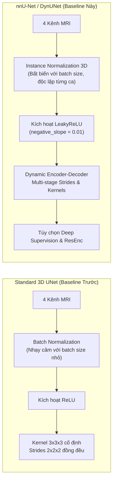

# Luồng Huấn Luyện nnU-Net (DynUNet) Baseline Trên Toàn Bộ Tập BraTS 2021

Tài liệu này đặc tả toàn diện kiến trúc, thiết lập thực nghiệm và hướng dẫn vận hành cho mô hình **nnU-Net (Dynamic U-Net / DynUNet)** trên **toàn bộ 1,251 ca bệnh nhân** của bộ dữ liệu quốc tế **RSNA-ASNR-MICCAI BraTS 2021**.

> **Các thành phần mã nguồn chính của luồng nnU-Net Baseline:**
> - Entrypoint CLI độc lập: [`scripts/run_nnunet_baseline.py`](file:///Users/truongledanchi/.gemini/antigravity/scratch/test/scripts/run_nnunet_baseline.py)
> - Cấu hình chuyên biệt: `get_nnunet_config()` trong [`src/config.py`](file:///Users/truongledanchi/.gemini/antigravity/scratch/test/src/config.py)
> - Kiến trúc mô hình động: `build_nnunet_model()` trong [`src/model.py`](file:///Users/truongledanchi/.gemini/antigravity/scratch/test/src/model.py)
> - Notebook chạy 1-click trên Kaggle: [`kaggle_nnunet_baseline_full.ipynb`](file:///Users/truongledanchi/.gemini/antigravity/scratch/test/kaggle_nnunet_baseline_full.ipynb)
> - File cấu hình Kaggle CLI: [`kernel-metadata-nnunet.json`](file:///Users/truongledanchi/.gemini/antigravity/scratch/test/kernel-metadata-nnunet.json)
> - Bộ kiểm thử tự động: [`tests/test_smoke_nnunet.py`](file:///Users/truongledanchi/.gemini/antigravity/scratch/test/tests/test_smoke_nnunet.py)

---

## 1. So Sánh Kiến Trúc: nnU-Net (DynUNet) vs. Standard 3D UNet

nnU-Net là tiêu chuẩn vàng (gold standard) trong phân đoạn hình ảnh y tế 3D nhờ loại bỏ các giả định cứng nhắc về kích thước và tối ưu hóa xử lý đặc trưng không gian:



### Điểm Khác Biệt Cốt Lõi:
1. **Chuẩn hóa Instance Normalization (`InstanceNorm3d`)**:
   - `BatchNorm3d` tính trung bình và phương sai trên toàn bộ batch, gây bất ổn định nghiêm trọng khi batch size nhỏ ($B \le 2$) trong ảnh 3D dung lượng lớn.
   - `InstanceNorm3d` tính toán thống kê độc lập trên từng kênh của từng thể tích bệnh nhân riêng biệt $\mu_{b,c}, \sigma_{b,c}$, giúp gradient ổn định tuyệt đối và loại bỏ hoàn toàn nguy cơ tràn số hoặc phụ thuộc batch.
2. **Hàm kích hoạt LeakyReLU ($\alpha = 0.01$)**:
   - Khắc phục hiện tượng "Dying ReLU" ở các vùng não nền (background) có giá trị voxel âm sau khi Z-score normalize.
3. **Dynamic Topology (DynUNet)**:
   - Tầng đầu tiên giữ nguyên độ phân giải không gian (`stride=(1, 1, 1)`), các tầng sau giảm dần theo `(2, 2, 2)`, cho phép trích xuất đặc trưng biên sắc nét hơn ở độ phân giải gốc.

---

## 2. Thiết Lập Trên Toàn Bộ Tập Dữ Liệu BraTS 2021 (1,251 Bệnh Nhân)

Toàn bộ 1,251 ca có nhãn chuyên gia được phân chia ngẫu nhiên nhưng tái lập tuyệt đối (`seed=42`) theo cấp độ bệnh nhân (*Patient-level*):

| Phân vùng tập dữ liệu | Tỷ lệ | Số lượng ca bệnh | Vai trò |
| :--- | :---: | :---: | :--- |
| **Training Set** | **80%** | **~1,000 ca** | Huấn luyện cập nhật trọng số mạng DynUNet |
| **Validation Set** | **10%** | **~125 ca** | Đánh giá trượt 3D định kỳ, chọn điểm dừng `best_metric_model.pth` |
| **Held-Out Test Set** | **10%** | **~126 ca** | Tập kiểm thử ẩn hoàn toàn, đánh giá độ khái quát hóa không thiên vị |

---

## 3. Ngân Sách Phần Cứng & Thời Gian Chạy Trên Kaggle

- **Phần cứng đề xuất**: Kaggle GPU T4 x2 (16 GB VRAM mỗi GPU, tổng 32 GB VRAM).
- **Phân bổ bộ nhớ**:
  - Script sử dụng `torch.nn.DataParallel` tự động chia đều batch size cho 2 GPU.
  - VRAM sử dụng: ~7.2 GB / GPU với batch size 4 (2 samples / GPU) ở patch size `(96, 96, 96)`.
- **Ước tính thời gian thực nghiệm**:
  - Với 1,000 ca training, 1 epoch mất khoảng **7.0 – 7.5 phút** trên 2x T4 GPU.
  - Chạy **65 epochs**: $65 \times 7.3\text{ phút} \approx 475\text{ phút} \approx \mathbf{8.0\text{ giờ}}$.
  - Quá trình Validation định kỳ và Held-Out Test (~126 ca): $\approx 30\text{ phút}$.
  - Tổng thời gian hoàn thành: **~8.5 giờ** (hoàn toàn an toàn trong giới hạn 12 giờ của Kaggle session).
  - Tích hợp cờ an toàn `--max-hours 11.5` để tự động ngắt và xuất kết quả nếu tiến gần mốc thời gian tối đa.

---

## 4. Hướng Dẫn Vận Hành

### Cách 1: Chạy Tự Động 1-Click Trên Kaggle (Đề Xuất Cho Toàn Bộ 1,251 Ca)

1. Mở Kaggle, tạo Notebook mới và chọn môi trường:
   - **Accelerator**: `GPU T4 x2`
   - **Internet**: `On`
   - **Persistence**: `Variables and Files`
2. Thêm dữ liệu BraTS 2021:
   - Nhấn **`+ Add Input`** $\rightarrow$ Tìm kiếm: **`brats-2021-task1`** (tác giả: `dschettler8845`).
3. Dán toàn bộ nội dung từ [`kaggle_nnunet_baseline_65epochs.ipynb`](file:///Users/truongledanchi/.gemini/antigravity/scratch/test/kaggle_nnunet_baseline_65epochs.ipynb) hoặc tải file notebook này lên Kaggle.
4. Nhấn **`Run All`** (hoặc **`Save Version` $\rightarrow$ `Run All (Save & Run, Background)`**).

### Hoặc Đẩy Trực Tiếp Bằng Kaggle CLI:
```bash
kaggle kernels push -p . -k kernel-metadata-nnunet-65epochs.json
```

---

### Cách 2: Chạy Trên Máy Trạm / Server Bằng Dòng Lệnh (CLI)

```bash
# Chạy đầy đủ 65 epochs trên toàn bộ tập dữ liệu với 2 GPU (hoặc 1 GPU)
python scripts/run_nnunet_baseline.py \
    --data-dir dataset/BraTS2021_Training_Data \
    --epochs 65 \
    --val-interval 13 \
    --roi-size 96 \
    --batch-size 4 \
    --sw-batch-size 4 \
    --lr 1e-3 \
    --optimizer adamw \
    --loss-type dice_bce \
    --no-amp \
    --num-workers 4 \
    --keep-latest \
    --output-dir outputs/nnunet \
    --checkpoint-dir checkpoints/nnunet
```

#### Các Tham Số Dòng Lệnh Hữu Ích:
- `--max-samples <N>`: Giới hạn số ca (mặc định: `None` = dùng toàn bộ 1,251 ca).
- `--optimizer {adamw, sgd}`: Chọn AdamW hoặc SGD (Nesterov momentum 0.99 chuẩn nnU-Net).
- `--no-amp`: Chạy thuần FP32 (khuyến nghị cho độ ổn định).
- `--max-hours 11.0`: Giới hạn thời gian bảo vệ tránh timeout container.
- `--resume checkpoints/nnunet/latest_model.pth`: Tiếp tục train tiếp nếu phiên trước dừng lại.
- `--dry-run`: Kiểm tra kết nối dữ liệu, in banner kiến trúc mà không chạy huấn luyện.

---

## 5. Cấu Trúc Kết Quả Đầu Ra (Outputs)

Sau khi hoàn tất, thư mục `outputs/nnunet/` sẽ tự động tạo ra bộ artifacts khoa học:
1. **`nnunet_metrics_report.json`**:
   - Bảng phân phối thống kê tập Held-Out Test (Mean, Std, Median, Min, Max).
   - Chi tiết từng ca bệnh nhân (Patient ID, Dice WT, TC, ET, HD95 mm).
   - Thời gian huấn luyện và cấu hình siêu tham số.
2. **`nnunet_learning_curves.png`**:
   - Đồ thị 3 bảng: Training Loss, Validation Dice qua các mốc, và Boundary Error HD95 (mm).
3. **`nnunet_test_predictions.png`**:
   - Ảnh lát cắt trực quan hóa Ground Truth vs Dự đoán của mô hình nnU-Net.
