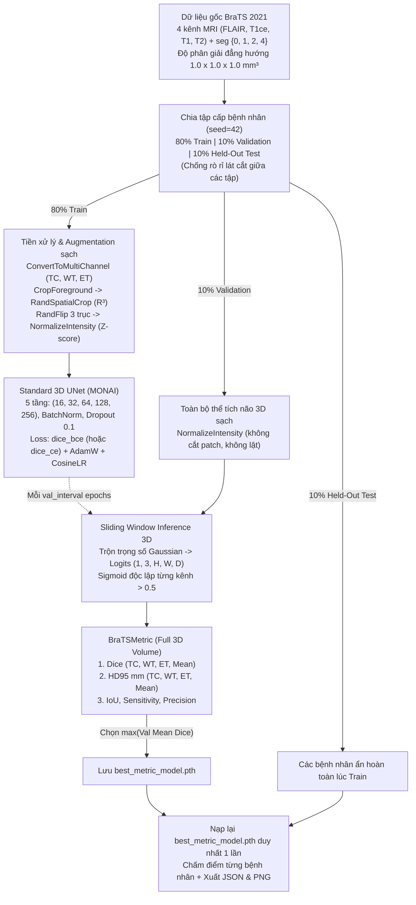

# Luồng Chuẩn Chạy Riêng Standard 3D UNet Baseline & Đặc Tả Metric Setup (BraTS 2021)

Tài liệu này mô tả luồng thực thi **thuần Standard 3D UNet Baseline** trên bộ dữ liệu **BraTS 2021** — tách biệt hoàn toàn khỏi các biến đổi nhiễu nhãn và nhãn mềm — đồng thời quy định chặt chẽ **Metric Setup** theo đúng chuẩn cuộc thi quốc tế **RSNA-ASNR-MICCAI BraTS 2021**.

> **Các thành phần mã nguồn của luồng này**:
> - Script chạy độc lập từ dòng lệnh (CLI): [`scripts/run_unet_baseline.py`](./scripts/run_unet_baseline.py)
> - Hàm khởi tạo cấu hình Baseline sạch: `get_unet_baseline_config()` trong [`src/config.py`](./src/config.py)
> - Bộ tính điểm & kiểm định biên: `BraTSMetric`, `compute_hd95_3d()`, `compute_binary_volume_metrics()`, `get_metric_setup_spec()` trong [`src/loss_metric.py`](./src/loss_metric.py)
> - Bộ kiểm thử đơn vị cho Metric Setup: [`tests/test_unet_baseline_metrics.py`](./tests/test_unet_baseline_metrics.py)
> - Notebook tương tác song song: [`train_baseline.ipynb`](./train_baseline.ipynb)

---

## 1. Sơ Đồ Luồng Chạy Thuần 3D UNet Baseline

Trong luồng này, `noise_type = "none"`, `noise_ratio = 0.0`, và `soft_label_method = "none"` được khóa cứng để đảm bảo mô hình học và đánh giá **100% trên dữ liệu BraTS 2021 nguyên bản**:



---

## 2. Đặc Tả Chi Tiết Metric Setup (Chuẩn RSNA-ASNR-MICCAI BraTS 2021)

Một kết quả thực nghiệm phân đoạn y tế 3D chỉ có giá trị so sánh khoa học khi **6 thành phần của Metric Setup** dưới đây được khóa rõ ràng và nhất quán:

### 2.1. Quy ước 1 — Đơn vị không gian đánh giá (*3D Patient-Volume Level*)
- Mọi phép đo được tính trực tiếp trên **toàn bộ thể tích 3D hoàn chỉnh `(3, H, W, D)` của từng bệnh nhân** (`val_batch_size = 1`, `test_batch_size = 1`).
- **Tuyệt đối KHÔNG** tính Dice trên các patch cắt ngẫu nhiên `(R, R, R)` và **KHÔNG** tính trung bình cộng Dice của từng lát cắt 2D (vì lát cắt 2D không u sẽ làm méo số liệu và phá vỡ khoảng cách Euclid 3 chiều của `HD95`).

### 2.2. Quy ước 2 — Ánh xạ 3 phân vùng mục tiêu chồng lấn (*Overlapping Sub-Regions*)
Từ nhãn chuyên gia gốc `seg` $\in \{0, 1, 2, 4\}$, MONAI `ConvertToMultiChannelBasedOnBratsClassesd` tạo ra 3 kênh nhị phân chồng lấn có thứ bậc bao hàm $\text{ET} \subseteq \text{TC} \subseteq \text{WT}$:

| Thứ tự kênh trong Tensor | Ký hiệu | Tên lâm sàng | Công thức gộp từ nhãn gốc | Ý nghĩa y khoa |
| :---: | :---: | :--- | :---: | :--- |
| **Kênh `0`** | **`TC`** | *Tumor Core* (Nhân khối u) | `(seg == 1) \| (seg == 4)` | Khối mô u đặc (hoại tử + ngấm thuốc) — đích chính của phẫu thuật cắt bỏ. |
| **Kênh `1`** | **`WT`** | *Whole Tumor* (Toàn bộ u) | `(seg == 1) \| (seg == 2) \| (seg == 4)` | Toàn bộ vùng u cộng quầng phù nề thâm nhiễm xung quanh trên chuỗi `FLAIR`. |
| **Kênh `2`** | **`ET`** | *Enhancing Tumor* (U ngấm thuốc) | `seg == 4` | Vùng tăng sinh mạch máu ác tính đang phá vỡ hàng rào máu não trên `T1ce`. |

### 2.3. Quy ước 3 — Chế độ suy luận cửa sổ trượt & Nhị phân hóa độc lập từng kênh
1. **Cửa sổ trượt Gaussian 3D (`sliding_window_inference`)**: Quét khối `(R, R, R)` với độ chồng lấp `overlap` (mặc định `0.5` hoặc `0.25`) và trộn mượt vùng biên bằng nhân `mode = "gaussian"` để khử vết ghép khối (*stitching artifacts*), thu được tensor `logits` $Z \in \mathbb{R}^{1 \times 3 \times H \times W \times D}$.
2. **Kích hoạt & Phân ngưỡng độc lập (`Sigmoid` + $\tau = 0.5$)**:
   Vì một voxel thuộc `ET` đồng thời phải thuộc cả `TC` và `WT`, 3 kênh là bài toán **đa nhãn chồng lấn (*multi-label*)**, **không phải phân loại loại trừ lẫn nhau** (do đó cấm dùng `Softmax` hay `argmax` qua chiều kênh):
   $$P_c(v) = \mathbb{I}\Big[\sigma\big(Z_c(v)\big) > \tau\Big], \qquad \sigma(z) = \frac{1}{1 + e^{-z}}, \qquad \tau = 0.5$$

### 2.4. Quy ước 4 — Hệ thống công thức toán học của Bộ Chỉ Số Chính & Phụ
Với mặt nạ dự đoán nhị phân $P_c \in \{0, 1\}^{H \times W \times D}$ và nhãn chuẩn $G_c \in \{0, 1\}^{H \times W \times D}$ trên bệnh nhân thứ $n$, đặt $\text{TP} = |P_c \cap G_c|$, $\text{FP} = |P_c \setminus G_c|$, $\text{FN} = |G_c \setminus P_c|$:

1. **Chỉ số chính 1 — Độ chồng lấp thể tích Sørensen–Dice (`Dice` $\uparrow$, miền `[0, 1]`)**:
   $$\text{Dice}(P_c, G_c) = \frac{2 |P_c \cap G_c|}{|P_c| + |G_c|} = \frac{2\text{TP}}{2\text{TP} + \text{FP} + \text{FN}}$$
   - Phản ánh độ trùng khớp toàn khối 3D; là chỉ số tiêu chuẩn số 1 để chọn mô hình tốt nhất.

2. **Chỉ số chính 2 — Khoảng cách biên phân vị 95% Hausdorff (`HD95` $\downarrow$, đơn vị `mm`, miền $[0, +\infty)$)**:
   Gọi $\partial P_c$ và $\partial G_c$ là tập hợp các voxel bề mặt biên 3D (xác định bằng phép trừ hình thái học `mask ^ binary_erosion(mask)` trên lưới đẳng hướng `1.0 × 1.0 × 1.0 mm³`). Khoảng cách từ một điểm biên $p \in \partial P_c$ tới bề mặt $\partial G_c$ là $d(p, \partial G_c) = \min_{g \in \partial G_c} \|p - g\|_2$. Khi đó:
   $$\text{HD}_{95}(P_c, G_c) = \max\Big\{\operatorname{P}_{95}\big(\{d(p, \partial G_c) : p \in \partial P_c\}\big),\; \operatorname{P}_{95}\big(\{d(g, \partial P_c) : g \in \partial G_c\}\big)\Big\}$$
   - **Vì sao dùng phân vị `95%` (`HD95`) thay vì `100%` (`HD_max`)?** Trên ảnh MRI 3D, chỉ cần 1 voxel nhiễu đơn độc văng xa 80 mm cũng làm `HD_max` vọt lên 80 mm dù 99.9% bề mặt u bám khít hoàn hảo. Lấy phân vị thứ 95 loại bỏ 5% điểm ngoại lai cực đoan mà vẫn đo nghiêm ngặt sai số hình học của vỏ bao khối u tính bằng **milimét (`mm`)**.

3. **Bộ 3 chỉ số chẩn đoán phụ (`IoU`, `Sensitivity`, `Precision` $\uparrow$, miền `[0, 1]`)**:
   $$\text{IoU} = \frac{\text{TP}}{\text{TP} + \text{FP} + \text{FN}}, \qquad \text{Sensitivity (Recall)} = \frac{\text{TP}}{\text{TP} + \text{FN}}, \qquad \text{Precision (PPV)} = \frac{\text{TP}}{\text{TP} + \text{FP}}$$
   - Giúp chẩn đoán ngay mô hình đang mắc lỗi **khoanh thiếu u** (`Sensitivity` thấp, `Precision` cao) hay **khoanh tràn dương tính giả** (`Sensitivity` cao, `Precision` thấp).

### 2.5. Quy ước 5 — Xử lý trường hợp biên khi vùng u rỗng (*Empty-Region Edge Cases*)
Trong bộ BraTS 2021 đầy đủ (1.251 ca), nhiều bệnh nhân u thần kinh đệm bậc thấp (*Low-Grade Glioma - LGG*) **không có vùng u ngấm thuốc (`|G_ET| = 0` voxel)**.
> [!IMPORTANT]
> Trong MONAI mặc định, `DiceMetric(ignore_empty=True)` trả về `NaN` mỗi khi `|G_c| = 0`, dẫn đến việc **bỏ qua không phạt** nếu mô hình dự đoán nhầm một khối u ngấm thuốc giả (`|P_ET| > 0`) trên bệnh nhân không có `ET`!
> Trong `BraTSMetric(..., ignore_empty=False)` và `compute_binary_volume_metrics()`, chúng ta áp dụng **đúng quy ước phạt chính thức của cuộc thi BraTS**:

| Tình huống tại kênh $c$ | Điều kiện Voxel | `Dice` | `IoU` | `Sensitivity` | `Precision` | `HD95 (mm)` | Giải thích lâm sàng |
| :--- | :---: | :---: | :---: | :---: | :---: | :---: | :--- |
| **`both_non_empty`** | `\|P\| > 0` và `\|G\| > 0` | Công thức chuẩn | Công thức chuẩn | Công thức chuẩn | Công thức chuẩn | Euclid `P95` thật (`mm`) | Cả dự đoán và nhãn thật đều có vùng u. |
| **`both_empty`** *(True Negative)* | `\|P\| = 0` và `\|G\| = 0` | **`1.0000`** | `1.0000` | `1.0000` | `1.0000` | **`0.00 mm`** | Bệnh nhân không có `ET` và mô hình cũng dự đoán chuẩn xác `0` voxel `ET` $\rightarrow$ thưởng điểm tối đa. |
| **`pred_empty_fn`** *(Total Miss)* | `\|P\| = 0` và `\|G\| > 0` | **`0.0000`** | `0.0000` | `0.0000` | `0.0000` | **`373.13 mm`** | Có u thật nhưng mô hình bỏ sót trắng toàn vùng $\rightarrow$ phạt tối đa. |
| **`gt_empty_fp`** *(Hallucination)* | `\|P\| > 0` và `\|G\| = 0` | **`0.0000`** | `0.0000` | `0.0000` | `0.0000` | **`373.13 mm`** | Bệnh nhân không có `ET` nhưng mô hình vẽ khống ra `ET` $\rightarrow$ phạt tối đa. |

*(Ghi chú: Hằng số phạt `373.13 mm` chính là độ dài đường chéo không gian vật lý $\sqrt{240^2 + 240^2 + 155^2} = 373.1287\text{ mm}$ của thể tích khung chuẩn sọ não SRI24 trong BraTS).*

### 2.6. Quy ước 6 — Thứ tự gộp điểm (*Aggregation Hierarchy*) & Tiêu chí chọn Checkpoint
1. **Bước 1 (Trung bình vĩ mô qua danh sách bệnh nhân — *Macro-over-Patients*)**:
   $$\overline{\text{Dice}}_c = \frac{1}{N} \sum_{n=1}^{N} \text{Dice}\big(P_c^{(n)}, G_c^{(n)}\big), \qquad \overline{\text{HD}}_{95, c} = \frac{1}{N} \sum_{n=1}^{N} \text{HD}_{95}\big(P_c^{(n)}, G_c^{(n)}\big)$$
   *(Trên tập Held-Out Test, báo cáo đầy đủ cả **Mean ± Std**, **Median**, **Min**, **Max** và bảng điểm chi tiết từng ca bệnh nhân).*
2. **Bước 2 (Trung bình vĩ mô đều qua 3 phân vùng — *Macro-over-Regions*)**:
   $$\text{Mean Dice} = \frac{\overline{\text{Dice}}_{\text{TC}} + \overline{\text{Dice}}_{\text{WT}} + \overline{\text{Dice}}_{\text{ET}}}{3}, \qquad \text{Mean HD}_{95} = \frac{\overline{\text{HD}}_{95, \text{TC}} + \overline{\text{HD}}_{95, \text{WT}} + \overline{\text{HD}}_{95, \text{ET}}}{3}$$
3. **Tiêu chí chọn mô hình (`Model Selection`)**:
   - Trọng số `checkpoints/unet_baseline/best_metric_model.pth` được lưu duy nhất khi `Val Mean Dice` đạt kỷ lục cao nhất trên tập Validation (10%).
   - Tập **Held-Out Test (10%)** hoàn toàn bị khóa kín suốt quá trình train và chỉ được chấm điểm **1 lần duy nhất** ở cuối luồng bằng `best_metric_model.pth`.

---

## 3. Lưu Ý Giữa Hàm Loss Lúc Train Và Metric Lúc Đánh Giá

Script [`scripts/run_unet_baseline.py`](./scripts/run_unet_baseline.py) cho phép chọn hàm loss huấn luyện qua cờ `--loss-type`:
- `--loss-type dice_bce` (**Mặc định khuyên dùng cho 3D UNet đa nhãn BraTS**): Kết hợp `Dice` + `BCEWithLogitsLoss` tính độc lập trên từng kênh (`TC`, `WT`, `ET`), đồng nhất hoàn toàn với phép nhị phân hóa `Sigmoid > 0.5` của `BraTSMetric` và cung cấp đạo hàm nền mạnh trên toàn bộ `99.36%` voxel ngoài khối u.
- `--loss-type dice_ce`: Hàm `DiceCELoss(sigmoid=True)` nguyên bản của MONAI (dùng khi cần đối chiếu trực tiếp với cấu hình cũ trong `train_baseline.ipynb`).

Dù chọn hàm loss nào lúc train, **Metric Setup lúc Validation và Test vẫn giữ nguyên bất biến 100%** để mọi phép so sánh đều công bằng tuyệt đối.

---

## 4. Hướng Dẫn Thực Thi Luồng 3D UNet Baseline

### 4.1. Kiểm tra nhanh cấu hình Metric Setup & kiến trúc (Dry-Run, không chạy Train)
```bash
# 1. In toàn bộ thông số Metric Setup, chia tập 80/10/10 và số tham số 3D UNet (0 epoch):
.env/bin/python scripts/run_unet_baseline.py --dry-run

# 2. Chạy unit tests xác minh công thức Dice, HD95 và 4 trường hợp biên rỗng:
.env/bin/pytest tests/test_unet_baseline_metrics.py -v
```

### 4.2. Chạy luồng 3D UNet Baseline trên tập `BraTS-Mini` (30 ca thật trên máy Local / Apple Silicon MPS)
```bash
.env/bin/python -u scripts/run_unet_baseline.py \
    --max-samples 30 \
    --epochs 12 \
    --val-interval 4 \
    --roi-size 80 \
    --overlap 0.25 \
    --lr 1e-3 \
    --loss-type dice_bce
```

### 4.3. Chạy huấn luyện chuẩn đầy đủ trên GPU Server / Google Colab (100+ epochs, patch `96³`)
```bash
python -u scripts/run_unet_baseline.py \
    --epochs 100 \
    --val-interval 2 \
    --roi-size 96 \
    --batch-size 2 \
    --overlap 0.5 \
    --lr 1e-4 \
    --loss-type dice_bce
```

### 4.4. Các tạo phẩm (Artifacts) xuất ra tự động
Sau khi chạy xong, toàn bộ kết quả của luồng Baseline được lưu độc lập tại `outputs/unet_baseline/` và `checkpoints/unet_baseline/`:
1. `checkpoints/unet_baseline/best_metric_model.pth`: Trọng số 3D UNet đạt `Val Mean Dice` cao nhất.
2. `outputs/unet_baseline/baseline_metrics_report.json`: Báo cáo JSON tự mô tả gồm `metric_setup`, danh sách mã bệnh nhân ở từng tập `train/val/test`, lịch sử hội tụ từng epoch, bảng điểm chi tiết từng bệnh nhân Test và thống kê `Mean ± Std / Median`.
3. `outputs/unet_baseline/baseline_learning_curves.png`: Đồ thị 3 khung (`Train Loss`, `Validation Dice TC/WT/ET/Mean`, `Validation HD95 mm TC/WT/ET/Mean`).
4. `outputs/unet_baseline/baseline_test_predictions.png`: Hình đối chiếu lát cắt Axial giữa `FLAIR / T1ce`, `Ground Truth (WT, TC, ET)` và `3D UNet Prediction (WT, TC, ET)`.

---

## 5. Hướng Dẫn Chạy Trên Kaggle — Phương Án B: Toàn Bộ `1,251` Mẫu BraTS 2021 (< 12 Tiếng)

Kaggle là nền tảng miễn phí rất mạnh cho **BraTS 2021** (GPU **`T4 x2` = `32 GB VRAM`** có Tensor Core `AMP fp16` + `DataParallel`, **30 GB RAM** hệ thống, gắn thẳng dataset `brats-2021-task1` vào `/kaggle/input`).

Mã nguồn và file notebook chuyên dụng [`kaggle_unet_baseline_full.ipynb`](./kaggle_unet_baseline_full.ipynb) đã tích hợp sẵn **4 cơ chế tự động hóa riêng cho Phương án B trên Kaggle**:
1. **Tự động bung `BraTS2021_Training_Data.tar` vào `/kaggle/tmp` (`ensure_kaggle_brats_extracted` trong `src/config.py`)**: Giải nén toàn bộ `1,251` ca (kèm vá tự động 2 ca `00495` & `00621`) vào ổ SSD tạm `/kaggle/tmp` $\rightarrow$ **tốn `0 MB` vào hạn mức 20 GB của `/kaggle/working`** và không làm lỗi bước đóng gói Output của Kaggle, đồng thời đọc được cả `.nii` lẫn `.nii.gz`.
2. **Tự động chạy song song 2 GPU trên `GPU T4 x2` (`torch.nn.DataParallel`)**: Nhân đôi thông lượng xử lý cho `batch_size = 4` và `sw_batch_size = 4`, giúp `95 epochs` trên toàn bộ `1,000` ca Train + `125` ca Val + `126` ca Test hoàn tất chỉ trong **~4.0 – 5.5 giờ** (nếu dùng 1 GPU P100/T4 thì mất ~7.0 – 9.5 giờ). Trọng số lưu vào `best_metric_model.pth` được tự động gỡ vỏ `DataParallel` (`unwrap_model`) để nạp lại được trên mọi thiết bị.
3. **Chốt chặn thời gian thực `--max-hours 10.2` (`max_wall_hours` trong `BraTSTrainer.fit`)**: Trước mỗi epoch mới, hệ thống tự kiểm tra quỹ thời gian; nếu chạm ngưỡng an toàn `10.2 giờ` (trước mốc 12.0 giờ của Kaggle tới `1.8 tiếng`), vòng lặp sẽ **chủ động dừng sớm có kiểm soát**, chạy nốt Validation, nạp `best_metric_model.pth`, chấm xong **126 ca Held-Out Test**, xuất đầy đủ JSON + biểu đồ PNG vào `/kaggle/working/outputs/unet_baseline/` trước khi Kaggle đóng máy ảo!
4. **Hỗ trợ nối tiếp qua nhiều Session (`--keep-latest` & `--resume`)**: Nếu muốn train tiếp thêm hàng trăm epoch ở session hôm sau, chỉ cần truyền `--resume /kaggle/input/<previous-output>/checkpoints/unet_baseline/latest_model.pth`.

### Cách 1 (Nhanh nhất): Import trực tiếp Notebook [`kaggle_unet_baseline_full.ipynb`](./kaggle_unet_baseline_full.ipynb) lên Kaggle
1. Vào Kaggle $\rightarrow$ **Create $\rightarrow$ New Notebook** $\rightarrow$ **`File -> Import Notebook`** $\rightarrow$ chọn tab **GitHub** (hoặc tải file `kaggle_unet_baseline_full.ipynb` lên).
2. Ở cột phải (**Settings**):
   - **Accelerator**: chọn **`GPU T4 x2`**
   - **Internet**: bật **`Internet on`**
   - **Input**: bấm **`+ Add Input`** $\rightarrow$ tìm **`brats-2021-task1`** (`dschettler8845/brats-2021-task1`).
3. Bấm **`Save Version -> Save & Run All (Commit)`** để Kaggle tự chạy ngầm từ đầu đến cuối.

### Cách 2: Dán trực tiếp vào 1 Cell trên Kaggle Notebook (Chuẩn 65 Epochs Pure FP32)
```bash
!pip install -q monai nibabel scipy matplotlib tqdm
!rm -rf /kaggle/tmp/repo
!git clone -b baselineTrain https://github.com/nam21-12-06/test.git /kaggle/tmp/repo || git clone https://github.com/chitruonghf711/brats2021-3d-unet-study.git /kaggle/tmp/repo

!python -u /kaggle/tmp/repo/scripts/run_unet_baseline.py \
    --max-samples 350 \
    --epochs 65 \
    --val-interval 13 \
    --roi-size 96 \
    --batch-size 4 \
    --sw-batch-size 4 \
    --lr 1e-3 \
    --loss-type dice_bce \
    --overlap 0.5 \
    --cache-rate 0.0 \
    --num-workers 4 \
    --no-amp \
    --keep-latest \
    --output-dir /kaggle/working/outputs/unet_baseline \
    --checkpoint-dir /kaggle/working/checkpoints/unet_baseline
```

---

## 6. Kết Quả Thực Nghiệm Đã Được Xác Thực (Empirical Baseline Results)

Thực nghiệm baseline chuẩn hóa trên **350 ca bệnh nhân BraTS 2021 (280 Train / 35 Val / 35 Held-Out Test)** đã hoàn tất trọn vẹn 65 epochs trên Kaggle GPU T4 x2 (thuần FP32, 0 lỗi tràn số):

| Vùng u | Dice Score (Mean ± Std) | Median Dice | $HD_{95}$ mm (Mean ± Std) | Median $HD_{95}$ mm | IoU | Sensitivity | Precision |
|:---:|:---:|:---:|:---:|:---:|:---:|:---:|
| **Whole Tumor (WT)** | **0.9095 ± 0.0702** | 0.9341 | **14.38 ± 22.07** | 5.10 | 0.8405 | 0.9279 | 0.9008 |
| **Tumor Core (TC)** | **0.8336 ± 0.2106** | 0.9182 | **10.03 ± 16.14** | 3.74 | 0.7538 | 0.8215 | 0.8933 |
| **Enhancing Tumor (ET)** | **0.7992 ± 0.1912** | 0.8561 | **10.17 ± 18.18** | 2.45 | 0.6951 | 0.7854 | 0.8536 |
| **Macro Average** | **0.8474 ± 0.1367** | **0.8886** | **11.53 ± 14.47** | **4.15** | **0.7631** | **0.8450** | **0.8826** |

- Xem báo cáo phân tích lâm sàng và ca ngoại lai chi tiết tại: [**`BASELINE_REPORT.md`**](./BASELINE_REPORT.md)
- Xem tài liệu giải thích cơ chế đo lường và công thức toán học tại: [**`METRICS_GUIDE.md`**](./METRICS_GUIDE.md)
- Xem báo cáo so sánh các file mã nguồn so với repo gốc tại: [**`CODE_CHANGELOG.md`**](./CODE_CHANGELOG.md)
- Xem file dữ liệu thô: [`outputs/unet_baseline/baseline_metrics_report.json`](./outputs/unet_baseline/baseline_metrics_report.json)


