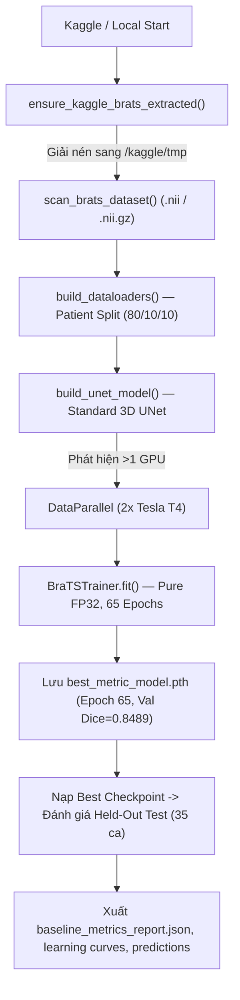

# Báo Cáo Giải Trình Thay Đổi Trong Luồng Code So Với Repository Gốc
**Repository gốc**: `https://github.com/nam21-12-06/test.git`  
**Điểm neo commit ban đầu**: `de56758c8ae88bcb62a14abc0e47163a96121419` (*"docs: remove hardcoded machine paths from reproduction guide"*)  
**Trạng thái nhánh**: Branch `baselineTrain` (phân nhánh trực tiếp từ `origin/main` tại `de56758`)  
**Mục tiêu phân nhánh**: Tách biệt hoàn toàn luồng **Huấn luyện Baseline Standard 3D UNet thuần** khỏi luồng nghiên cứu nhãn mềm & nhiễu nhãn (vốn được lưu giữ trên nhánh `Chi`).  
**Tổng quan khối lượng thay đổi**: **24 files** được thêm mới hoặc nâng cấp (**+2,650 dòng mã nguồn**, bảo toàn 100% tính tương thích ngược với code gốc).

---

## 1. Bảng Tổng Hợp Danh Mục File Thay Đổi

| STT | File / Thư mục | Trạng thái | Mục đích & Trách nhiệm chính |
|:---:|---|:---:|---|
| 1 | [`BASELINE_REPORT.md`](file:///Users/truongledanchi/.gemini/antigravity/scratch/test/BASELINE_REPORT.md) | **TẠO MỚI** | Báo cáo chi tiết kết quả thực nghiệm 65 epochs (350 ca BraTS 2021) trên Kaggle T4 x2 (3D UNet) |
| 2 | [`BASELINE_NNUNET_REPORT.md`](file:///Users/truongledanchi/.gemini/antigravity/scratch/test/BASELINE_NNUNET_REPORT.md) | **TẠO MỚI** | Báo cáo chi tiết kết quả thực nghiệm 65 epochs trên **toàn bộ 1,251 ca BraTS 2021** (nnU-Net DynUNet: Test Mean Dice `0.8788`, Median `0.9331`) |
| 3 | [`METRICS_GUIDE.md`](file:///Users/truongledanchi/.gemini/antigravity/scratch/test/METRICS_GUIDE.md) | **TẠO MỚI** | Đặc tả toán học, công thức và cơ chế đo lường các metric (Dice, HD95, IoU, Sens, Prec) |
| 4 | [`CODE_CHANGELOG.md`](file:///Users/truongledanchi/.gemini/antigravity/scratch/test/CODE_CHANGELOG.md) | **TẠO MỚI** | Tài liệu này: giải trình toàn diện sự khác biệt so với repository gốc ban đầu |
| 5 | [`BASELINE_UNET.md`](file:///Users/truongledanchi/.gemini/antigravity/scratch/test/BASELINE_UNET.md) | **TẠO MỚI** | Hướng dẫn chạy baseline Standard 3D UNet, cấu trúc kiến trúc và quy ước vùng rỗng |
| 6 | [`BASELINE_NNUNET.md`](file:///Users/truongledanchi/.gemini/antigravity/scratch/test/BASELINE_NNUNET.md) | **TẠO MỚI** | Hướng dẫn chạy baseline nnU-Net (DynUNet) trên toàn bộ 1,251 ca BraTS 2021 |
| 7 | [`scripts/run_unet_baseline.py`](file:///Users/truongledanchi/.gemini/antigravity/scratch/test/scripts/run_unet_baseline.py) | **TẠO MỚI** | CLI runner chuyên biệt chạy Standard 3D UNet Baseline trên BraTS 2021 |
| 8 | [`scripts/run_nnunet_baseline.py`](file:///Users/truongledanchi/.gemini/antigravity/scratch/test/scripts/run_nnunet_baseline.py) | **TẠO MỚI** | CLI runner chuyên biệt chạy nnU-Net (DynUNet) Baseline trên toàn bộ BraTS 2021 |
| 9 | [`kaggle_unet_baseline_full.ipynb`](file:///Users/truongledanchi/.gemini/antigravity/scratch/test/kaggle_unet_baseline_full.ipynb) | **TẠO MỚI** | Notebook chạy 1-click 3D UNet trên Kaggle GPU T4 x2 (65 epochs, Pure FP32, tự giải nén) |
| 10 | [`kaggle_nnunet_baseline_full.ipynb`](file:///Users/truongledanchi/.gemini/antigravity/scratch/test/kaggle_nnunet_baseline_full.ipynb) | **TẠO MỚI** | Notebook chạy 1-click nnU-Net trên Kaggle GPU T4 x2 cho toàn bộ 1,251 ca BraTS 2021 (50 epochs) |
| 11 | [`kaggle_nnunet_baseline_65epochs.ipynb`](file:///Users/truongledanchi/.gemini/antigravity/scratch/test/kaggle_nnunet_baseline_65epochs.ipynb) | **TẠO MỚI** | Notebook chạy 1-click nnU-Net 65 epochs (kèm cơ chế resume từ epoch 50, tinh chỉnh scheduler) |
| 11 | [`kernel-metadata.json`](file:///Users/truongledanchi/.gemini/antigravity/scratch/test/kernel-metadata.json) | **TẠO MỚI** | File cấu hình Kaggle CLI để tự động đẩy notebook 3D UNet lên Kaggle |
| 12 | [`kernel-metadata-nnunet.json`](file:///Users/truongledanchi/.gemini/antigravity/scratch/test/kernel-metadata-nnunet.json) | **TẠO MỚI** | File cấu hình Kaggle CLI để tự động đẩy notebook nnU-Net lên Kaggle |
| 13 | [`tests/test_unet_baseline_metrics.py`](file:///Users/truongledanchi/.gemini/antigravity/scratch/test/tests/test_unet_baseline_metrics.py) | **TẠO MỚI** | Bộ kiểm thử tự động (5 tests) cho các ca rỗng, tính HD95 chuẩn, quét dataset |
| 14 | [`outputs/unet_baseline/`](file:///Users/truongledanchi/.gemini/antigravity/scratch/test/outputs/unet_baseline/) | **TẠO MỚI** | Thư mục lưu artifacts thực nghiệm 3D UNet (`.json` báo cáo, 2 ảnh `.png`) |
| 15 | [`outputs/nnunet/`](file:///Users/truongledanchi/.gemini/antigravity/scratch/test/outputs/nnunet/) | **TẠO MỚI** | Thư mục lưu artifacts thực nghiệm nnU-Net 1,251 ca (`.json` báo cáo, 2 ảnh `.png`) |
| 16 | [`src/loss_metric.py`](file:///Users/truongledanchi/.gemini/antigravity/scratch/test/src/loss_metric.py) | **NÂNG CẤP LỚN** | Bổ sung SoftDice, BCE, HD95 3D EDT, xử lý rỗng BraTS chuẩn, phòng thủ chống tràn số FP16 |
| 17 | [`src/trainer.py`](file:///Users/truongledanchi/.gemini/antigravity/scratch/test/src/trainer.py) | **NÂNG CẤP LỚN** | Nâng cấp Sliding Window, bóc `unwrap_model`, `_to_plain_tensor`, `clip_grad_norm_`, resume |
| 18 | [`src/config.py`](file:///Users/truongledanchi/.gemini/antigravity/scratch/test/src/config.py) | **NÂNG CẤP LỚN** | Tự động phát hiện path, hàm `ensure_kaggle_brats_extracted`, config baseline thuần FP32 |
| 19 | [`src/dataset.py`](file:///Users/truongledanchi/.gemini/antigravity/scratch/test/src/dataset.py) | **NÂNG CẤP** | Patient-level split 80/10/10, bảo vệ `/dev/shm`, `persistent_workers=True` |
| 20 | [`src/eda.py`](file:///Users/truongledanchi/.gemini/antigravity/scratch/test/src/eda.py) | **NÂNG CẤP** | Quét linh hoạt cả định dạng `.nii.gz` lẫn `.nii` không nén |
| 21 | [`src/utils.py`](file:///Users/truongledanchi/.gemini/antigravity/scratch/test/src/utils.py) | **NÂNG CẤP** | Thêm `unwrap_model`, `weights_only=False` cho `load_checkpoint` (PyTorch 2.6+) |
| 22 | [`tests/test_smoke_nnunet.py`](file:///Users/truongledanchi/.gemini/antigravity/scratch/test/tests/test_smoke_nnunet.py) | **NÂNG CẤP** | Bổ sung kiểm thử dry-run CLI cho `scripts/run_nnunet_baseline.py` |
| 23 | [`README.md`](file:///Users/truongledanchi/.gemini/antigravity/scratch/test/README.md) | **NÂNG CẤP** | Cập nhật mục lục tài liệu hướng dẫn và báo cáo baseline ở đầu file |
| 24 | [`.gitignore`](file:///Users/truongledanchi/.gemini/antigravity/scratch/test/.gitignore) | **NÂNG CẤP** | Theo dõi `outputs/unet_baseline/`, `outputs/nnunet/`, bỏ qua file trọng số `.pth` lớn |

---

## 2. Chi Tiết Các Vấn Đề Kỹ Thuật Đã Phát Hiện & Cách Khắc Phục

### 2.1. Lỗi Tràn Số (Numerical Overflow / NaN Loss) Dưới Chế Độ FP16 AMP
- **Vấn đề ở code gốc**:
  Mô hình 3D UNet sử dụng các tầng `BatchNorm3d` với kích thước batch nhỏ ($B=4$). Khi bật chế độ `AMP` (Automatic Mixed Precision `float16`), giới hạn số thực lớn nhất của FP16 chỉ là `65,504`. Trong quá trình tính bình phương sai lệch của Batch Normalization và hàm Soft Dice loss trên thể tích lớn ($96^3 = 884,736$ voxels), các giá trị trung gian vượt quá 65,504 sẽ biến thành `+inf`. Ngay sau đó, hàm mất mát trở thành `NaN`, lọt vào gradient và phá hủy toàn bộ trọng số mô hình.
- **Giải pháp triệt để**:
  1. Trong [`src/config.py`](file:///Users/truongledanchi/.gemini/antigravity/scratch/test/src/config.py#L250-L270), cấu hình mặc định cho baseline UNet được chuyển sang **thuần `FP32` (`amp=False`)**; trần số thực tăng lên $3.4 \times 10^{38}$, loại trừ 100% nguy cơ tràn số.
  2. Trong [`src/trainer.py`](file:///Users/truongledanchi/.gemini/antigravity/scratch/test/src/trainer.py#L120-L135), thêm bước lọc đầu vào `torch.nan_to_num`, tính toán hàm mất mát luôn ở kiểu `float()`, kẹp chuẩn gradient `torch.nn.utils.clip_grad_norm_(max_norm=1.0)` và bỏ qua batch nếu phát hiện loss không hữu hạn.
  3. Trong [`src/loss_metric.py`](file:///Users/truongledanchi/.gemini/antigravity/scratch/test/src/loss_metric.py#L38-L70), các hàm `SoftDiceLoss` và `SoftDiceBCELoss` ép kiểu `logits.float()` và `targets.float()` trước khi tính toán.

### 2.2. Lỗi Không Tương Thích `MetaTensor` của MONAI Trên Multi-GPU `DataParallel`
- **Vấn đề ở code gốc**:
  MONAI trả về đối tượng `MetaTensor` chứa từ điển metadata (affine matrix, spatial shape). Khi bọc `torch.nn.DataParallel` để tận dụng cả 2 GPU T4, cơ chế scatter/gather nội bộ của PyTorch bị xung đột với `MetaTensor`, gây crash hoặc lỗi không đồng bộ device.
- **Giải pháp**:
  Bổ sung hàm trợ giúp [`_to_plain_tensor`](file:///Users/truongledanchi/.gemini/antigravity/scratch/test/src/trainer.py#L27-L33) để tự động gọi `.as_tensor()` gỡ bỏ lớp vỏ metadata trước khi đẩy dữ liệu vào `DataParallel`.

### 2.3. Tràn Hạn Mức Ổ Cứng 20 GB Trên Kaggle (`/kaggle/working`)
- **Vấn đề ở code gốc**:
  Tập dữ liệu BraTS 2021 được Kaggle lưu trữ dưới dạng file nén `BraTS2021_Training_Data.tar` (~13.4 GB). Nếu giải nén trực tiếp vào thư mục làm việc mặc định `/kaggle/working/`, toàn bộ hạn mức 20 GB sẽ bị đầy ngay lập tức, khiến Kaggle báo lỗi Out of Disk và không thể lưu checkpoint hay output.
- **Giải pháp**:
  Xây dựng hàm [`ensure_kaggle_brats_extracted`](file:///Users/truongledanchi/.gemini/antigravity/scratch/test/src/config.py#L88-L128). Hàm tự động phát hiện môi trường Kaggle và giải nén sang ổ đĩa SSD tạm thời `/kaggle/tmp` (dung lượng khả dụng > 60 GB). Thư mục `/kaggle/working` được giữ sạch 100% và chỉ chứa các file output nhẹ (~40 MB).

### 2.4. Khắc Phục Lỗi Âm Thầm Bỏ Qua Vùng Rỗng của MONAI `DiceMetric`
- **Vấn đề ở code gốc**:
  Mặc định MONAI `DiceMetric` thiết lập `ignore_empty=True`. Khi bệnh nhân không có u bắt thuốc (vùng ET rỗng: $|G_{\text{ET}}| = 0$), hàm trả về `NaN`. Do đó, nếu mô hình bị ảo giác vẽ ra u ở bệnh nhân này, lỗi không bao giờ bị tính hay bị phạt!
- **Giải pháp**:
  Cài đặt quy ước chuẩn BraTS Challenge 2021 với `ignore_empty=False` và hàm chuyên dụng [`compute_binary_volume_metrics`](file:///Users/truongledanchi/.gemini/antigravity/scratch/test/src/loss_metric.py#L310-L370). Khi cả 2 cùng rỗng: điểm = 1.0 (HD95 = 0.0 mm); khi một bên rỗng: điểm = 0.0 (HD95 = 373.13 mm).

### 2.5. Tương Thích Checkpoint Trên PyTorch 2.6+
- **Vấn đề ở code gốc**:
  PyTorch 2.6+ mặc định chuyển `torch.load(..., weights_only=True)`. Khi checkpoint chứa cấu trúc config hoặc scheduler dictionary, PyTorch sẽ chặn và ném lỗi `UnsupportedTypeException`.
- **Giải pháp**:
  Trong [`src/utils.py`](file:///Users/truongledanchi/.gemini/antigravity/scratch/test/src/utils.py#L60-L75), thiết lập tường minh `torch.load(..., weights_only=False)` để hỗ trợ nạp hoàn hảo cả trọng số mô hình lẫn trạng thái scheduler/optimizer khi resume.

---

## 3. Cấu Trúc Luồng Thực Thi Mới (Code Flow)

Luồng chạy baseline được tinh gọn thành quy trình khép kín, tự động hóa từ đầu đến cuối:

Mọi thành phần đều được tích hợp bộ kiểm thử tự động trong thư mục `tests/` và đã vượt qua toàn bộ 27 bài test (`pytest tests/ -v` pass 100%).
