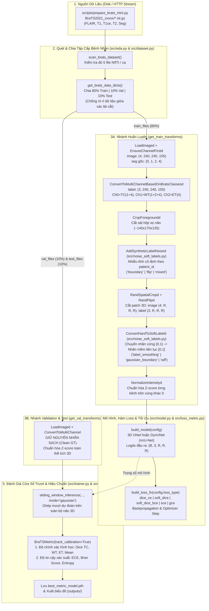

# Tài Liệu Chi Tiết Luồng Mã Nguồn (Codebase Architecture & Execution Flow)

Tài liệu này trình bày chi tiết kiến trúc, luồng đi của dữ liệu (tensor shapes ở từng bước) và mối liên kết giữa các module trong repository **Phân đoạn khối u não 3D (BraTS 2021)** phục vụ nghiên cứu **Label Noise, Soft Label & Uncertainty Calibration**.

> Xem thêm các tài liệu đi kèm:
> - Động lực khoa học & tổng quan dự án: [`README_SOFTLABEL_NOISE.md`](./README_SOFTLABEL_NOISE.md)
> - Đặc tả datasets, quy trình chuyên gia & ý nghĩa lâm sàng của cơ chế tiêm nhiễu: [`DATASETS.md`](./DATASETS.md)
> - Báo cáo phân tích kết quả thực nghiệm: [`EXPERIMENTAL_REPORT.md`](./EXPERIMENTAL_REPORT.md)

---

## 1. Sơ Đồ Tổng Quan Luồng Thực Thi (End-to-End Pipeline)



---

## 2. Bản Đồ Phân Tầng Các File Trong Repo

| Nhóm | Đường dẫn File | Trách nhiệm cốt lõi | Gọi tới Module nào |
| :--- | :--- | :--- | :--- |
| **Cấu hình** | `src/config.py` | Định nghĩa `BaselineConfig`, tự nhận diện phần cứng (`cuda`/`mps`/`cpu`), tìm đường dẫn dataset động và cung cấp các preset thí nghiệm (`get_softlabel_study_config`). | Độc lập (gốc cấu hình) |
| **Khám phá dữ liệu** | `src/eda.py` | Quét thư mục bệnh nhân, kiểm tra tính toàn vẹn 5 chuỗi NIfTI, thống kê tỷ lệ voxel u và vẽ lát cắt MRI đa phương thức. | Độc lập (`nibabel`, `matplotlib`) |
| **Nhiễu & Nhãn mềm** | `src/noise_soft_labels.py` | Tạo nhiễu nhãn 3D có kiểm soát (`corrupt_label_3d`, `AddSyntheticLabelNoised`) và sinh nhãn mềm liên tục (`generate_soft_label_3d`, `ConvertHardToSoftLabeld`). | Độc lập (`torch`, `scipy.ndimage`, `monai.transforms`) |
| **Dữ liệu & Loader** | `src/dataset.py` | Chia tập 80/10/10 cấp bệnh nhân, lắp ráp chuỗi biến đổi MONAI cho Train/Val/Test và khởi tạo `DataLoader` / `CacheDataset`. | `src/eda.py`, `src/noise_soft_labels.py` |
| **Kiến trúc mạng** | `src/model.py` | Khởi tạo mạng **Standard 3D UNet** hoặc **nnU-Net (`DynUNet`)**, thống kê số tham số và dung lượng mô hình. | `src/config.py` |
| **Loss & Metric** | `src/loss_metric.py` | Cung cấp 7 hàm loss (chuẩn, nhãn mềm, kháng nhiễu) và bộ đo `BraTSMetric` kèm hiệu chuẩn xác suất (`ECE`, `Brier Score`). | Độc lập (`torch`, `monai.losses`, `monai.metrics`) |
| **Huấn luyện** | `src/trainer.py` | Vòng lặp `BraTSTrainer` (`train_epoch`, `validate` bằng cửa sổ trượt 3D, quản lý AMP, lưu checkpoint tốt nhất, `evaluate` tập Test). | `src/config.py`, `src/loss_metric.py`, `src/utils.py` |
| **Tiện ích & Vẽ** | `src/utils.py` | Cố định seed ngẫu nhiên, lưu/nạp checkpoint, vẽ đường cong hội tụ, so sánh nhãn nhiễu/nhãn mềm và bản đồ bất định (Entropy Map). | Độc lập |
| **Scripts chạy tự động** | `scripts/prepare_brats_mini.py`<br/>`scripts/run_noise_softlabel_study.py` | Tải streaming dữ liệu `BraTS-Mini` qua HTTP; chạy tự động thực nghiệm đối sánh đa nhánh và xuất báo cáo JSON + PNG. | Toàn bộ `src/*` |
| **Notebooks** | `train_baseline.ipynb`<br/>`train_nnunet_baseline.ipynb`<br/>`train_softlabel_noise_study.ipynb` | Giao diện trực quan từng bước chạy được trên cả máy cá nhân (Mac/Windows) lẫn Google Colab. | Toàn bộ `src/*` |

---

## 3. Phân Tích Chi Tiết Từng Giai Đoạn Trong Luồng Code

### Giai đoạn 1: Khởi tạo Cấu hình & Tìm Dữ liệu Động (`src/config.py`)
1. **`resolve_dataset_dir()`**: Tự động dò tìm thư mục chứa các ca `BraTS2021_xxxxx` theo thứ tự ưu tiên: đường dẫn người dùng truyền vào $\rightarrow$ biến môi trường `BRATS_DATA_DIR` $\rightarrow$ `dataset/BraTS2021_Training_Data` trong workspace $\rightarrow$ đường dẫn Google Colab / Google Drive. Nhờ đó không bao giờ phải sửa đường dẫn cứng trong code.
2. **`get_default_device()`**: Tự động chọn `"cuda"` (GPU NVIDIA), `"mps"` (GPU Apple Silicon M1/M2/M3/M4), hoặc `"cpu"`.
3. **`get_softlabel_study_config(preset=...)`**: Đóng gói sẵn các cấu hình thí nghiệm chuẩn hóa (`clean`, `noisy_baseline`, `noisy_soft_sdf`, `noisy_soft_gaussian`, `noisy_sce`, `noisy_gce`) để đảm bảo mọi nhánh so sánh dùng chung các siêu tham số nền tảng.

---

### Giai đoạn 2: Quét Dữ liệu & Chia Tập Không Rò Rỉ (`src/eda.py` $\rightarrow$ `src/dataset.py`)
1. **`scan_brats_dataset(data_dir)`** (`src/eda.py`):
   - Duyệt từng thư mục con `BraTS2021_xxxxx`.
   - Kiểm tra sự tồn tại của đủ 5 file `.nii.gz`: `flair`, `t1`, `t1ce`, `t2`, và `seg`.
   - Đóng gói thành dictionary chuẩn cho MONAI:
     ```python
     {
         "patient_id": "BraTS2021_00000",
         "image": [flair_path, t1ce_path, t1_path, t2_path],  # 4 kênh đầu vào
         "label": seg_path                                    # Nhãn phân đoạn gốc
     }
     ```
2. **`get_brats_data_dicts(...)`** (`src/dataset.py`):
   - Xáo trộn danh sách hồ sơ theo `seed` cố định **ở cấp độ bệnh nhân** (không bao giờ chia ngẫu nhiên theo lát cắt 2D vì các lát cắt kề nhau của cùng một bệnh nhân rất giống nhau, dễ gây rò rỉ dữ liệu - *data leakage*).
   - Tách thành 3 danh sách độc lập: `train_files` (80%), `val_files` (10%), `test_files` (10%).

---

### Giai đoạn 3: Biến Đổi Tensor, Tiêm Nhiễu Tĩnh & Sinh Nhãn Mềm (`src/dataset.py` & `src/noise_soft_labels.py`)

Đây là trái tim của hướng nghiên cứu **Label Noise / Soft Label**. Thứ tự các phép biến đổi trong `get_train_transforms()` được sắp xếp có chủ đích về mặt toán học lẫn tốc độ tính toán:

1. **Đọc & Chuyển nhãn đa kênh BraTS (`ConvertToMultiChannelBasedOnBratsClassesd`)**:
   - Từ nhãn nguyên bản 1 kênh `{0: nền, 1: hoại tử NCR, 2: phù nề ED, 4: u ngấm thuốc ET}`, chuyển thành **tensor nhị phân 3 kênh chồng lấp** `(3, H, W, D)`:
     - **Kênh `0` (`TC` - Tumor Core)**: `seg == 1` hoặc `seg == 4`
     - **Kênh `1` (`WT` - Whole Tumor)**: `seg == 1` hoặc `seg == 2` hoặc `seg == 4`
     - **Kênh `2` (`ET` - Enhancing Tumor)**: `seg == 4`
   - *Lưu ý quan trọng*: Bất biến bao hàm giải phẫu luôn là $\text{ET (kênh 2)} \subseteq \text{TC (kênh 0)} \subseteq \text{WT (kênh 1)}$.

2. **Cắt hộp sọ (`CropForegroundd`)**:
   - Loại bỏ khoảng không gian đen (`0.0`) bên ngoài hộp sọ, thu nhỏ thể tích từ `(240, 240, 155)` về khoảng `(136, 171, 146)` mà không mất bất kỳ voxel não hay khối u nào.

3. **Tiêm nhiễu nhãn tĩnh theo từng bệnh nhân (`AddSyntheticLabelNoised`) — Đặt TRƯỚC khi cắt Patch ngẫu nhiên**:
   - **Tại sao đặt trước khi crop ngẫu nhiên và dùng seed băm `MD5(base_seed:patient_id)`?**
     Trong thực tế lâm sàng, sai số gán nhãn của bác sĩ trên bệnh nhân A là **tĩnh (cố định)** qua mọi epoch (mô hình có nguy cơ học thuộc lòng - *memorize* - vết vẽ sai đó). Nếu sinh nhiễu ngẫu nhiên lại mỗi epoch, nhiễu đối xứng sẽ tự triệt tiêu trung bình như một phép tăng cường dữ liệu. Nhờ băm `MD5(seed, patient_id)` và đặt trước bước crop ngẫu nhiên:
     - Mỗi bệnh nhân mang một bản nhãn nhiễu 3D cố định xuyên suốt quá trình huấn luyện mà **không tốn dung lượng ổ cứng lưu thêm file NIfTI**.
     - `CacheDataset` của MONAI tự động lưu kết quả sau bước này vào RAM ở epoch 1, giúp từ epoch 2 trở đi thời gian tạo nhiễu bằng **0 giây**.
   - **Tối ưu hình thái học 3D tách chiều & Cổng không gian mượt (`_morph_dilate_3d` / `_morph_erode_3d` + `_smooth_binary_gate_3d`)**:
     Phép giãn/co hình lập phương bán kính $r$ dùng 3 lượt `max_pool3d` 1 chiều liên tiếp `(k,1,1) -> (1,k,1) -> (1,1,k)` có độ phức tạp $O(3k)$ thay vì $O(k^3)$ (nhanh hơn ~30–60 lần). Dải vành đai giãn/co sau đó được nhân với trường chỉ báo trơn 3D (`coarse_stride=8` nội suy *trilinear*) để tạo các vết lồi/lõm liền mạch giống nét cọ 3D của bác sĩ thay vì nhiễu muối tiêu rời rạc.
   - **Mô phỏng lỗi cấp vùng có ràng buộc hộp sọ (`flip` / `mixed`)**:
     Chỉ lấy tọa độ bên trong nhu mô não `brain_fg = (raw_image[0].abs() > 1e-5)` để chèn các khối `ellipsoid` 3D dương tính giả (*tumor mimics*), đồng thời lấy tâm từ `tumor_coords` để khoét các lỗ `ellipsoid` âm tính giả (*annotation fatigue*).
   - **Bảo toàn thứ bậc giải phẫu (`_enforce_brats_hierarchy`)**: Cưỡng bức lại điều kiện `ET (ch 2) <= TC (ch 0) <= WT (ch 1)` sau mọi phép biến dạng. *(Xem bảng giải thích đầy đủ 5 tình huống lâm sàng tương ứng tại [`DATASETS.md` Mục 3.2](./DATASETS.md)).*

4. **Cắt Patch 3D & Lật trục (`RandSpatialCropd` + `RandFlipd`)**:
   - Trích xuất khối lập phương `(4, R, R, R)` (ví dụ `80x80x80` hoặc `96x96x96`) và lật ngẫu nhiên theo 3 trục không gian để tăng cường dữ liệu.

5. **Sinh Nhãn Mềm liên tục (`ConvertHardToSoftLabeld`) — Đặt SAU khi cắt Patch**:
   - Đặt sau bước crop giúp `scipy.ndimage.distance_transform_edt` (`sdf`) và tích chập Gaussian 3D tách chiều (`gaussian_boundary`) chỉ tính trên khối `80x80x80` thay vì toàn bộ não, tăng tốc gấp ~10 lần:
     - `'label_smoothing'`: $y_{\text{soft}} = (1 - \alpha)y + 0.5\alpha$.
     - `'gaussian_boundary'`: Làm mờ biên u bằng bộ lọc Gaussian 3D tách chiều với độ lệch chuẩn $\sigma$.
     - `'sdf'`: Tính khoảng cách Euclid có dấu từ ranh giới u $\text{SDF}(x) = d_{\text{trong}}(x) - d_{\text{ngoài}}(x)$, rồi đưa qua hàm Sigmoid có nhiệt độ $\tau$:
       $$y_{\text{soft}}(x) = \frac{1}{1 + \exp(-\text{SDF}(x) / \tau)}$$
       Tại đúng ranh giới u, xác suất chuyển mượt quanh `0.5`; càng sâu trong lõi u càng tiến về `1.0`; càng xa ngoài nền càng tiến về `0.0`.

> **Nguyên tắc vàng ở Nhánh Validation & Test (`get_val_transforms`)**:
> Không bao giờ tiêm nhiễu hay làm mềm nhãn ở tập Validation và Test. Mọi mô hình (dù học từ nhãn bẩn hay nhãn mềm) đều phải được chấm điểm đối chiếu với **nhãn sạch chuẩn (Clean Ground Truth)** trên các bệnh nhân chưa từng thấy.

---

### Giai đoạn 4: Mô Hình 3D UNet & Hàm Loss Kháng Nhiễu (`src/model.py` & `src/loss_metric.py`)

1. **Luồng Tensor qua `build_model(config)`**:
   - Đầu vào: `images` kích thước `(B, 4, R, R, R)` (ví dụ `(2, 4, 80, 80, 80)`).
   - Đi qua 5 tầng Encoder `(16 -> 32 -> 64 -> 128 -> 256)` với bước nhảy `stride = 2` (kích thước không gian giảm dần `80 -> 40 -> 20 -> 10 -> 5`) và nhánh Decoder đối xứng có kết nối tắt (*skip connections*).
   - Đầu ra: `logits` chưa qua kích hoạt, kích thước `(B, 3, R, R, R)`. Khi suy luận, xác suất từng vùng u được tính độc lập bằng `probs = torch.sigmoid(logits)`.

2. **Các Hàm Loss trong `build_loss_fn()` (`src/loss_metric.py`)**:
   - `dice_ce` / `dice` / `dice_focal`: Các hàm loss baseline chuẩn của MONAI cho nhãn cứng `{0, 1}`.
   - `soft_dice` (`SoftDiceLoss`): Dùng mẫu số bình phương chuẩn $L_2$:
     $$\mathcal{L}_{\text{SoftDice}}(p, y) = 1 - \frac{2 \sum p_i y_i + \epsilon}{\sum p_i^2 + \sum y_i^2 + \epsilon}$$
     *Ý nghĩa toán học*: Đạo hàm theo $p_i$ triệt tiêu khi và chỉ khi $p_i = y_i$ với mọi $y_i \in [0, 1]$, giữ nguyên tính hiệu chuẩn xác suất của nhãn mềm (khác với mẫu số bậc nhất $\sum p_i + \sum y_i$ vốn ép $p_i$ đẩy về cực trị `{0, 1}`).
   - `soft_dice_bce` (`SoftDiceBCELoss`): Kết hợp `SoftDiceLoss` với `BCEWithLogitsLoss` tính độc lập trên từng kênh (tránh lỗi dùng Softmax cạnh tranh chéo giữa 3 vùng chồng lấn WT, TC, ET).
   - `sce` (`DiceSymmetricBCELoss`): Kết hợp chiều thuận BCE và chiều nghịch Reverse-BCE $\mathcal{L}_{\text{SCE}} = \alpha \text{BCE}(p, y) + \beta \text{RBCE}(p, y)$ cộng `SoftDiceLoss`, giúp chặn hiện tượng mô hình học vẹt các voxel gán nhãn sai.
   - `gce` (`DiceGeneralizedCELoss`): Hàm mất mát tổng quát Box-Cox $\frac{1 - p_t^q}{q}$ ($q \in (0, 1]$), tự động giảm trọng số gradient đối với các mẫu có độ lệch cực đoan nghi ngờ là nhiễu nhãn.

---

### Giai đoạn 5: Huấn Luyện, Suy Luận Cửa Sổ Trượt & Đo Hiệu Chuẩn (`src/trainer.py`)

Khi gọi `trainer.fit(train_loader, val_loader)` trong `BraTSTrainer`:
1. **`train_epoch()`**:
   - Duyệt từng batch patch 3D `(B, 4, R, R, R)` $\rightarrow$ `logits = model(images)` $\rightarrow$ `loss = loss_fn(logits, labels)` $\rightarrow$ lan truyền ngược cập nhật trọng số và bước giảm `lr_scheduler`.
2. **`validate()` & `evaluate()` với `sliding_window_inference`**:
   - Vì ảnh MRI đánh giá là toàn bộ thể tích não 3D lớn hơn kích thước patch `R`, MONAI trượt một cửa sổ `(R, R, R)` có độ chồng lấp `overlap` (ví dụ `0.25` hoặc `0.5`) khắp thể tích não và trộn mượt các vùng giao nhau bằng trọng số Gaussian (`mode="gaussian"`).
3. **Tính điểm `BraTSMetric` (`src/loss_metric.py`)**:
   - Phân ngưỡng `sigmoid(preds) > 0.5` để tính **Dice TC, Dice WT, Dice ET, và Mean Dice**.
   - Nếu `track_calibration=True`, gọi thêm `compute_calibration_stats()` trên xác suất liên tục chưa phân ngưỡng để đo:
     - **Brier Score**: Sai số bình phương trung bình $\mathbb{E}[(p - y)^2]$ (càng thấp càng tốt).
     - **ECE (Expected Calibration Error)**: Độ lệch giữa độ tự tin dự đoán và tần suất đúng thực nghiệm qua 10 khoảng chia (càng thấp càng tốt).
4. **Lưu Checkpoint**: Mỗi khi `Mean Dice` trên tập Validation vượt kỷ lục cũ, lưu trọng số vào `best_metric_model.pth`. Cuối cùng nạp lại đúng `best_metric_model.pth` này để chấm điểm một lần duy nhất trên `test_loader`.

---

## 4. Hướng Dẫn Mở Rộng Nhanh Cho Nghiên Cứu Tiếp Theo

- **Thêm phương pháp tạo nhiễu nhãn mới** (ví dụ: nhiễu biến dạng đàn hồi *Elastic Deformation Noise*):
  $\rightarrow$ Thêm nhánh xử lý trong hàm `corrupt_label_3d()` tại `src/noise_soft_labels.py` và khai báo tên vào `VALID_NOISE_TYPES`.
- **Thêm phương pháp sinh Soft Label mới** (ví dụ: làm mềm thích ứng theo gradient cường độ ảnh MRI FLAIR/T1ce):
  $\rightarrow$ Thêm nhánh trong `generate_soft_label_3d()` tại `src/noise_soft_labels.py` và khai báo vào `VALID_SOFT_METHODS`.
- **Thêm hàm Loss kháng nhiễu mới** (ví dụ: *Early-Learning Regularization - ELR* hoặc *Peer Loss*):
  $\rightarrow$ Viết class kế thừa `nn.Module` trong `src/loss_metric.py` và đăng ký khóa vào `build_loss_fn()`.
- **Chạy thực nghiệm tự động nhiều cấu hình**:
  $\rightarrow$ Thêm preset vào `get_softlabel_study_config()` trong `src/config.py` rồi chạy lệnh:
  ```bash
  .env/bin/python scripts/run_noise_softlabel_study.py --presets clean noisy_baseline noisy_soft_sdf noisy_sce
  ```

