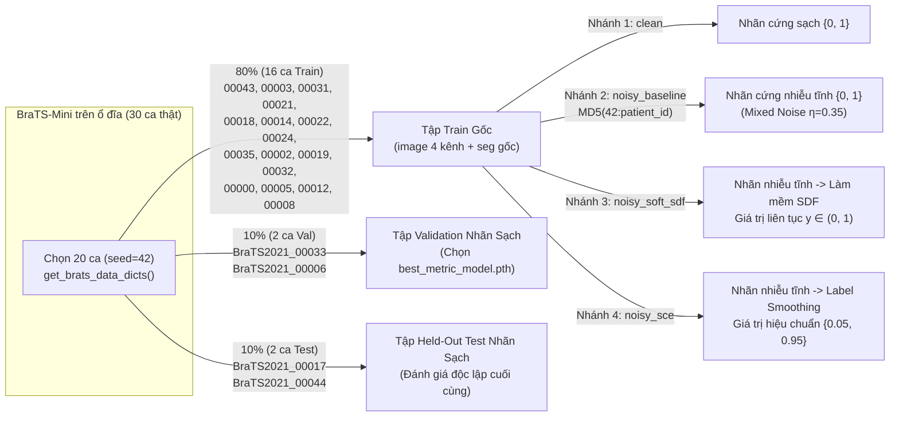

# Mô Tả Chi Tiết Các Bộ Dữ Liệu (Datasets) Trong Luồng Thực Nghiệm

Tài liệu này mô tả đầy đủ **các tầng dữ liệu đã được khởi tạo và thực thi** trong dự án khảo sát **3D UNet với Label Noise & Soft Labels**, giải thích rõ **vì sao từng loại dữ liệu được lựa chọn** và **cách thức chúng vận hành xuyên suốt mã nguồn**.

> Xem thêm các tài liệu liên quan:
> - Tổng quan công việc & hướng dẫn chạy: [`README_SOFTLABEL_NOISE.md`](./README_SOFTLABEL_NOISE.md)
> - Sơ đồ luồng code chi tiết: [`CODE_FLOW.md`](./CODE_FLOW.md)
> - Báo cáo phân tích kết quả thực nghiệm: [`EXPERIMENTAL_REPORT.md`](./EXPERIMENTAL_REPORT.md)

---

## 1. Tổng Quan 3 Tầng Dữ Liệu Đã Thực Thi Trong Hệ Thống

Trong quá trình kiểm thử và chạy thực nghiệm đối sánh, hệ thống không chỉ dùng một nguồn dữ liệu đơn lẻ mà phối hợp **3 tầng dữ liệu chuyên biệt**, mỗi tầng đảm nhiệm một vai trò khoa học và kỹ thuật riêng:

| Tầng dữ liệu | Tên gọi trong Repo | Quy mô & Dung lượng | Mục đích cốt lõi | Vị trí định nghĩa / Lưu trữ |
| :--- | :--- | :--- | :--- | :--- |
| **Tầng 1: Dữ liệu lâm sàng gốc** | **BraTS 2021 (`BraTS-Mini`)** | **30 ca MRI 3D thật** (`150` files `.nii.gz`, `292.47 MB`) | Huấn luyện, Validation và chấm điểm Benchmark thực tế trên giải phẫu u não người thật. | `dataset/BraTS2021_Training_Data/` (`scripts/prepare_brats_mini.py`) |
| **Tầng 2: Tập giám sát phái sinh trên RAM** | **Derived Noisy & Soft-Label Sets** (`clean`, `noisy_baseline`, `noisy_soft_sdf`, `noisy_sce`) | Sinh động từ tập Train thực tế (**0 MB** tốn thêm trên đĩa) | Mô phỏng sai số gán nhãn tĩnh của bác sĩ và tạo nhãn mềm liên tục $[0, 1]$ có kiểm soát định lượng. | `src/noise_soft_labels.py` `src/dataset.py` |
| **Tầng 3: Dữ liệu giả lập & Phantom toán học** | **`SyntheticVolumeDataset`** & **`Nested BraTS Phantom`** | Khối 3D `16³` – `40³` sinh tức thời trong `pytest` | Kiểm chứng bất biến toán học, gradient hàm loss, thứ bậc `ET <= TC <= WT` và chạy Smoke Tests siêu tốc. | `tests/test_noise_softlabel.py` `tests/test_smoke.py` `tests/test_smoke_nnunet.py` |

---

## 2. Tầng 1: Bộ Dữ Liệu Lâm Sàng Thực Tế `BraTS 2021` (`BraTS-Mini`)

### 2.1. Bản chất y sinh & Cấu trúc kỹ thuật
Dữ liệu được trích xuất trực tiếp từ bộ dữ liệu chuẩn quốc tế **RSNA-ASNR-MICCAI BraTS 2021** (*Brain Tumor Segmentation Challenge 2021*), tập hợp ảnh chụp cộng hưởng từ (MRI) sọ não trước phẫu thuật của bệnh nhân u thần kinh đệm (*glioma*) thu thập từ nhiều bệnh viện khác nhau.

Mỗi ca bệnh nhân (`BraTS2021_xxxxx`) bao gồm **5 thể tích 3D định dạng NIfTI (`.nii.gz`)** đã được tiền xử lý chuẩn y khoa (đồng đăng ký không gian về khung chuẩn giải phẫu SRI24, nội suy đẳng hướng `1.0 × 1.0 × 1.0 mm³`, và tách bỏ hộp sọ - *skull-stripped*), kích thước ma trận đồng nhất **`240 × 240 × 155` (`8,928,000` voxels/chuỗi)**:

1. **`*_flair.nii.gz` (Fluid Attenuated Inversion Recovery)**: Triệt tín hiệu dịch não tủy, làm sáng rõ vùng phù nề quanh u (*Peritumoral Edema*) và toàn bộ phạm vi thâm nhiễm (**WT**).
2. **`*_t1ce.nii.gz` (T1-weighted Contrast-Enhanced)**: Chụp T1 sau tiêm thuốc đối quang từ Gadolinium, làm sáng rực vòng u tăng sinh mạch máu đang hoạt động mạnh (**ET**) bao quanh lõi hoại tử tối màu (**NCR**).
3. **`*_t1.nii.gz` (Native T1-weighted)**: Phản ánh cấu trúc giải phẫu chất trắng – chất xám cơ sở và đối chiếu với `T1ce` để phân biệt máu tụ với mô ngấm thuốc.
4. **`*_t2.nii.gz` (T2-weighted)**: Nhạy với hàm lượng nước mô học, hỗ trợ xác định ranh giới phù nề và nang dịch trong nhân u.
5. **`*_seg.nii.gz` (Expert Ground Truth Segmentation)**: Mặt nạ gán nhãn đồng thuận bởi các bác sĩ chẩn đoán hình ảnh thần kinh với kiểu dữ liệu số nguyên `uint8`, chỉ nhận **1 trong 4 giá trị rời rạc** tại mỗi voxel:
   - `0`: Nền & nhu mô não bình thường (*Background*)
   - `1`: Nhân u hoại tử không ngấm thuốc (*Necrotic Tumor Core - NCR*)
   - `2`: Mô phù nề thâm nhiễm quanh u (*Peritumoral Edematous/Invaded Tissue - ED*)
   - `4`: Vùng u ngấm thuốc mạnh (*GD-Enhancing Tumor - ET*)

### 2.2. Giải đáp chuyên sâu: Có bao nhiêu chuyên gia gán nhãn mỗi ca BraTS 2021 & Mỗi voxel lưu cái gì?

#### A. Quy trình có bao nhiêu chuyên gia tham gia gán nhãn 1 sample trong BraTS 2021?
Theo công bố chính thức của **RSNA-ASNR-MICCAI BraTS 2021** (*Baid et al., 2021*) và chuẩn tiền thân (*Menze et al., IEEE TMI 2015*), bộ dữ liệu được xây dựng từ hai nhánh quy trình chuyên gia:
1. **Nhóm các ca kế thừa từ BraTS 2012–2020**:
   - Mỗi ca chụp được khoanh vùng thủ công độc lập bởi **từ 1 đến 4 chuyên gia (*1–4 raters*)** theo cùng một quy ước giải phẫu học thần kinh.
   - Khi có nhiều người gán nhãn (điển hình **4 chuyên gia** trên tập lõi), các bản vẽ rời rạc được trộn bằng thuật toán xác suất **STAPLE** (*Simultaneous Truth and Performance Level Estimation* — ước lượng đồng thời nhãn thật và độ tin cậy của từng bác sĩ) có xét thứ bậc vùng u, sau đó được kiểm duyệt chốt bởi bác sĩ X-quang thần kinh cao cấp (*board-certified neuroradiologist*).
2. **Nhóm các ca mở rộng mới của RSNA–ASNR năm 2021** (huy động hơn 60 bác sĩ X-quang thần kinh tình nguyện của Hiệp hội *ASNR*):
   - **Bước 0 (Khởi tạo nháp tự động)**: Hợp nhất dự đoán từ tổ hợp (*ensemble*) các mô hình vô địch các kỳ BraTS trước (`nnU-Net`, `DeepScan`, `DeepMedic`) để tạo mặt nạ sơ bộ.
   - **Tầng chuyên gia 1 (*Annotator*)**: **1 bác sĩ / học viên chuyên sâu X-quang thần kinh** chỉnh sửa thủ công tỉ mỉ từng lát cắt 3D trên cả 4 chuỗi MRI bằng phần mềm ITK-SNAP.
   - **Tầng chuyên gia 2 (*Approver*)**: **1 bác sĩ X-quang thần kinh cao cấp độc lập (> 10–15 năm kinh nghiệm)** rà soát lại toàn bộ ca bệnh. Nếu phát hiện vùng ranh giới chưa chuẩn xác, ca chụp được trả lại sửa vòng lặp (*iterative refinement*) cho tới khi Approver ký duyệt.

#### B. Mỗi voxel trong file `*_seg.nii.gz` chỉ là `0/1/2/4` cứng hay có lưu số lượng bác sĩ bầu chọn từng nhãn?
- **Khẳng định trực tiếp (đã kiểm chứng trên header NIfTI thực tế trong repo)**:
  Mỗi sample bệnh nhân trong **BraTS 2021** **CHỈ CÓ DUY NHẤT 1 FILE NHÃN `*_seg.nii.gz`** (`dtype = uint8`, kích thước `(240, 240, 155)`). Tại mỗi tọa độ voxel $(x, y, z)$, file này **CHỈ LƯU MỘT CON SỐ NGUYÊN CỨNG DUY NHẤT thuộc tập $\{0, 1, 2, 4\}$**.
- **KHÔNG CÓ thông tin phiếu bầu cá nhân**: Bộ BraTS 2021 công khai **không công bố** các file gán nhãn riêng lẻ của từng bác sĩ trước khi gộp STAPLE / trước khi Approver chốt. Tức là tại một voxel có giá trị `2`, ta **không biết** đó là do `4/4` bác sĩ cùng đồng thuận chọn `2`, hay `3` người chọn `2` và `1` người chọn `4` — toàn bộ phương sai bất đồng giữa các chuyên gia (*inter-observer variance*) đã bị **nén cứng (*collapsed*)** thành một nhãn đồng thuận duy nhất!
- **Chi tiết lịch sử đắt giá về lý do khuyết mã nhãn số `3`**:
  Trong các kỳ BraTS đầu tiên (2012–2016) từng tồn tại nhãn `3` (*Non-Enhancing solid Tumor* — khối u đặc không ngấm thuốc). Tuy nhiên từ BraTS 2017 trở đi, hội đồng chuyên gia ASNR/MICCAI quyết định **xóa bỏ nhãn `3` và gộp thẳng vào nhãn `1`** vì ngay cả giữa các bác sĩ đầu ngành cũng **bất đồng ý kiến quá lớn (nhiễu nhãn nội tại quá cao)** khi cố phân biệt ranh giới giữa nhãn `1` và nhãn `3` trên MRI thường quy! Việc chuỗi nhãn nhảy cóc `0, 1, 2, 4` chính là dấu tích lịch sử trực tiếp của bài toán **Label Ambiguity / Label Noise** trong y văn BraTS.

#### C. Minh họa cụ thể giá trị của 1 Voxel biên u biến đổi qua luồng dữ liệu của chúng ta
Giả sử xét một voxel $(x_0, y_0, z_0)$ nằm sát rìa ngoài vùng u ngấm thuốc (trong file gốc có `seg = 4`, cách ranh giới mô phù nề chỉ `1` voxel):

| Giai đoạn trong Pipeline | Dạng lưu trữ & Kiểu dữ liệu | Giá trị cụ thể tại voxel $(x_0, y_0, z_0)$ | Ý nghĩa vật lý / toán học |
| :--- | :--- | :--- | :--- |
| **1. File gốc trên đĩa (`*_seg.nii.gz`)** | 1 kênh rời rạc `uint8` | `4` | Nhãn đồng thuận cứng duy nhất (không có đếm phiếu chuyên gia). |
| **2. Chuyển đa kênh BraTS (`ConvertToMultiChannel...`)** | 3 kênh chồng lấn `float32` `[Ch0=TC, Ch1=WT, Ch2=ET]` | `[1.0, 1.0, 1.0]` | Voxel thuộc `ET (4)` nên đồng thời thuộc cả `TC (1+4)` và `WT (1+2+4)`. |
| **3. Nhánh `noisy_baseline` (`corrupt_label_3d`)** | 3 kênh nhiễu tĩnh `float32` | Ví dụ bị co biên `ET`: `[1.0, 1.0, 0.0]` | Mô phỏng 1 bác sĩ khoanh hụt vùng `ET` nhưng vẫn tính trong `TC` và `WT` (giữ bất biến `ET <= TC <= WT`). |
| **4A. Nhánh `noisy_soft_sdf` (`generate_soft_label_3d`)** | 3 kênh xác suất mềm `float32` $\in (0, 1)$ | Ví dụ: `[0.88, 0.96, 0.34]` | Khoảng cách Euclid có dấu `SDF` tự động gán độ tin cậy thấp (`0.34`) ngay sát biên tranh chấp, nhưng giữ độ tin cậy cao (`0.96`) vì vẫn nằm sâu trong lòng `WT`! |
| **4B. Nhánh `noisy_sce` (`label_smoothing`)** | 3 kênh làm trơn đồng nhất `float32` | `[0.95, 0.95, 0.05]` | Kìm hãm độ tự tin tuyệt đối `{0, 1}` thành `{0.05, 0.95}` để tránh bùng nổ gradient khi gặp nhãn sai. |

### 2.3. Thống kê thực nghiệm trên 30 ca `BraTS-Mini` đã tải trong Workspace
Tập `BraTS-Mini` hiện lưu tại `dataset/BraTS2021_Training_Data` gồm **30 ca hoàn chỉnh** (`BraTS2021_00000` đến `BraTS2021_00045`, tổng dung lượng `292.47 MB`):

| Vùng mục tiêu đánh giá BraTS | Tổ hợp nhãn gốc | Trung bình ± Độ lệch chuẩn (30 ca) | Nhỏ nhất (Min) | Lớn nhất (Max) | Số ca khuyết vùng u (`0` voxel) |
| :--- | :--- | :---: | ---: | ---: | :---: |
| **Whole Tumor (`WT`)** — Kênh `1` | `1 + 2 + 4` | `97,330 ± 60,778` voxels (`~97.3 cm³`) | `16,636` | `263,809` | `0 / 30` |
| **Tumor Core (`TC`)** — Kênh `0` | `1 + 4` | `29,807 ± 35,035` voxels (`~29.8 cm³`) | `327` | `171,947` | `0 / 30` |
| **Enhancing Tumor (`ET`)** — Kênh `2` | `4` | `16,359 ± 15,085` voxels (`~16.4 cm³`) | `224` | `64,578` | `0 / 30` |

### 2.4. Vì sao chọn `BraTS-Mini` (30 ca thật) cho luồng nghiên cứu này?
1. **Tính chân thực lâm sàng cho bài toán Soft Label / Uncertainty**: Khác với khối u tạng đặc có vỏ bao rõ ràng, u thần kinh đệm (*glioma*) xâm lấn lan tỏa dọc các bó sợi thần kinh nên ranh giới trên MRI chuyển tiếp mờ dần. Đây chính là bài toán y khoa điển hình nhất mà nhãn cứng `{0, 1}` bộc lộ hạn chế và nhãn mềm (`SDF`, `Gaussian`) phát huy giá trị.
2. **Đa dạng kích thước tổn thương cực lớn**: Trong 30 ca này, nhân u `TC` biến thiên từ ca rất nhỏ (`327` voxels $\approx 0.33\text{ cm}^3$) tới ca khổng lồ (`171,947` voxels $\approx 172\text{ cm}^3$), và **100% số ca đều có đủ cả 3 vùng `WT`, `TC`, `ET`**, giúp phép đo Dice không bị suy biến mẫu số bằng 0.
3. **Cân bằng tối ưu giữa độ chính xác thực tế và ràng buộc phần cứng**: Toàn bộ 1.251 ca BraTS 2021 chiếm ~13 GB file nén (~70 GB sau giải nén) — vượt quá dung lượng trống của máy cá nhân và mất hàng chục giờ mỗi lượt train. Cơ chế HTTP Streaming trong [`scripts/prepare_brats_mini.py`](./scripts/prepare_brats_mini.py) rút đúng 30 ca thật chỉ tốn `292 MB`, cho phép khảo sát trọn vẹn 4 nhánh **3D UNet** trong chưa đầy 10 phút trên Apple M1 (`mps`) mà vẫn giữ nguyên 100% đặc tính nhiễu MRI thật và cấu trúc code của repo gốc.

---

## 3. Tầng 2: Các Tập Giám Sát Phái Sinh Cho Nghiên Cứu Nhiễu & Nhãn Mềm

### 3.1. Vì sao phải tự sinh biến thể Nhiễu & Nhãn mềm từ Ground Truth sạch?
Trong nghiên cứu học máy với **Label Noise**, ngoài những nguyên nhân lâm sàng khiến dữ liệu thực tế luôn lẫn sai số (độ đồng thuận giữa các chuyên gia chỉ đạt `74% – 85%` Dice, nhãn bệnh viện thường chỉ do 1 người khoanh nhanh không qua hội đồng duyệt, và mạng 3D UNet dễ học vẹt nhãn sai — xem phân tích đầy đủ tại [`README_SOFTLABEL_NOISE.md` Mục 1.1](./README_SOFTLABEL_NOISE.md)), nếu nhà nghiên cứu chỉ dùng một bộ dữ liệu thô vốn đã bẩn mà **không có bản nhãn chuẩn sạch đối chứng** thì sẽ **không thể đo chính xác**:
1. Mức độ lỗi thực sự trong tập huấn luyện là bao nhiêu phần trăm?
2. Khi tăng mức nhiễu từ nhẹ ($\eta = 0.10$) lên rất nặng ($\eta = 0.50$), mô hình suy sụp nhanh đến đâu?
3. Trên bệnh nhân mới, mô hình dự đoán trúng **khối u thật** hay chỉ đang lặp lại **thói quen khoanh lẹm sai** của người gán nhãn?

Do đó, thiết kế chuẩn trong các công trình MICCAI / IEEE TMI là lấy nhãn đồng thuận chuyên gia của BraTS 2021 làm **Chân lý gốc (*Clean Anchor*)**, giữ nguyên nhãn sạch tuyệt đối ở tập **Validation** và **Test**, đồng thời biến đổi có kiểm soát nhãn của tập **Train** thành các tập giám sát phái sinh.

### 3.2. Giải mã 5 cơ chế tiêm nhiễu trong `src/noise_soft_labels.py`: Mô phỏng chính xác những tình huống lâm sàng nào?
Khác hẳn cách lật ngẫu nhiên từng pixel kiểu "nhiễu muối tiêu" (*salt-and-pepper noise* — hiện tượng phi thực tế không bao giờ xảy ra khi bác sĩ vẽ bằng tay), hàm `corrupt_label_3d()` và transform `AddSyntheticLabelNoised` trong [`src/noise_soft_labels.py`](./src/noise_soft_labels.py) được thiết kế với **5 cơ chế toán học tương ứng trực tiếp với 5 hiện tượng sai số lâm sàng có thật**:

| TT | Cơ chế trong mã nguồn (`src/noise_soft_labels.py`) | Tình huống thực tế ngoài bệnh viện được mô phỏng | Vì sao chi tiết thiết kế này quan trọng? |
| :-: | :--- | :--- | :--- |
| **1** | **Nhiễu ranh giới trơn 3D (`boundary`)**: `_morph_dilate_3d` + `_morph_erode_3d` nhân với cổng không gian mượt `_smooth_binary_gate_3d` (`coarse_stride=8`, nội suy *trilinear*) | **Lệch nét cọ 3D & khác biệt trường phái giữa các bác sĩ (*Over- / Under-segmentation*)**: Bác sĩ xạ trị thường khoanh rộng tay ra ngoài quầng sáng FLAIR để tránh sót tế bào u vi thể; bác sĩ phẫu thuật lại khoanh thu hẹp vào vùng rõ nét để bảo tồn não lành. | Nét cọ (*3D brush* / *polygon*) của con người trong ITK-SNAP / 3D Slicer luôn tạo ra các mảng phình ra ở góc này và lẹm vào ở góc kia một cách **liền khối, trơn tru**, không bao giờ vỡ vụn từng pixel rời rạc. |
| **2** | **Chèn khối cầu dẹt dương tính giả (`flip` / `mixed` — nhánh `blob`)**: Sinh các khối `ellipsoid` 3D bán kính `3–10` voxels giới hạn chặt trong mặt nạ nhu mô não `brain_fg = (image[0].abs() > 1e-5)` | **Nhầm "tổn thương giả u" (*Tumor Mimics / False Positives*)**: Trên MRI (đặc biệt ở người lớn tuổi), các đốm thoái hóa chất trắng mạch nhỏ, sẹo thần kinh đệm (*gliosis*), mạch máu ngấm thuốc cắt ngang hoặc nhiễu ảnh cũng phát sáng trên `FLAIR`/`T1ce`, dễ bị người ít kinh nghiệm hoặc AI nháp khoanh nhầm là ổ u vệ tinh. | Ràng buộc `brain_fg` đảm bảo các đốm khoanh nhầm **chỉ xuất hiện bên trong nhu mô não thật** — vì ngoài đời không bác sĩ nào khoanh nhầm khối u ra khoảng không khí đen bên ngoài hộp sọ! |
| **3** | **Khoét lỗ âm tính giả (`flip` / `mixed` — nhánh `hole`)**: Lấy tâm ngẫu nhiên trong vùng u hiện hữu (`tumor_coords`) và khoét đi các khối `ellipsoid` 3D | **Mệt mỏi khi gán nhãn & bỏ sót vùng u (*Annotation Fatigue / False Negatives*)**: Một ca MRI có tới `155` lát cắt. Cuối ca trực, người vẽ dễ bỏ quên một ổ u đa ổ nhỏ (*multifocal lesion*), quên tô tiếp ở các lát cắt cực trên/dưới, hoặc bỏ trống mảng hoại tử nằm khuất. | Tái hiện đúng dạng lỗi khuyết vùng có cấu trúc khối 3D thay vì đục thủng từng điểm đơn lẻ. |
| **4** | **Cưỡng bức thứ bậc bao hàm giải phẫu**: `_enforce_brats_hierarchy(work)` khóa bất biến `ET (ch 2) <= TC (ch 0) <= WT (ch 1)` | **Quy tắc bản đồ nhãn đơn nhất của phần mềm y khoa**: Bác sĩ vẽ trên một mặt nạ rời rạc `{0, 1, 2, 4}`, nên theo định nghĩa giải phẫu vùng `ET (4)` bắt buộc nằm trong `TC (1+4)` và `TC` bắt buộc nằm trong `WT (1+2+4)`. | Ngăn chặn việc sinh ra các tổ hợp nhãn vô nghĩa về mặt y học (như một voxel được đánh dấu là u ngấm thuốc `ET` nhưng lại không thuộc toàn bộ khối u `WT`). |
| **5** | **Hạt giống băm cố định theo mã bệnh nhân**: `_stable_patient_seed` (`MD5(seed:patient_id)`) kết hợp `CacheDataset` lưu tĩnh trên RAM | **Nhãn lỗi lưu cứng một lần trong PACS bệnh viện (*Static Dataset Noise*)**: Một ca bệnh bị khoanh sai một lần rồi lưu cố định vào ổ cứng bệnh viện — suốt 100 epoch huấn luyện, mạng AI luôn nhìn thấy **đúng vết khoanh sai y hệt nhau** ở bệnh nhân đó. | Nếu mỗi epoch lại sinh ngẫu nhiên một vết lỗi mới, các lỗi đối xứng qua nhiều epoch sẽ tự triệt tiêu về trung bình (biến thành phép *Data Augmentation* có lợi chứ không còn kiểm tra được khả năng chống **học vẹt nhãn sai**!). |

### 3.3. Sơ đồ phân tách & sử dụng dữ liệu trong thực nghiệm Pilot Study

### 3.4. Dữ liệu được nạp và biến đổi từng bước như thế nào khi chạy?

#### A. Luồng xử lý một bệnh nhân ở **Tập Huấn Luyện (`train_loader`)** (`src/dataset.py`):
1. **Ghép 4 kênh ảnh đầu vào (`src/eda.py` $\rightarrow$ `LoadImaged`)**:
   Đọc 4 file NIfTI theo đúng thứ tự cố định `[FLAIR, T1ce, T1, T2]` thành tensor 4 chiều `(4, 240, 240, 155)`.
2. **Ánh xạ nhãn 3 kênh chồng lấn (`ConvertToMultiChannelBasedOnBratsClassesd`)**:
   Chuyển file `seg` sang tensor float `(3, 240, 240, 155)` với thứ tự kênh chuẩn MONAI:
   - `label[0]` = **TC** (`seg == 1 | seg == 4`)
   - `label[1]` = **WT** (`seg == 1 | seg == 2 | seg == 4`)
   - `label[2]` = **ET** (`seg == 4`)
3. **Cắt sát hộp sọ (`CropForegroundd`)**:
   Dựa trên vùng `image > 0`, gọt bỏ khoảng không đen ngoài hộp sọ, giảm kích thước xuống khoảng `(4, 136, 171, 146)` để mạng tập trung 100% năng lực tính toán vào nhu mô não.
4. **Tiêm nhiễu tĩnh cố định theo bệnh nhân & Lưu Cache RAM (`AddSyntheticLabelNoised` + `CacheDataset`)**:
   - Với các nhánh có nhiễu (`noisy_baseline`, `noisy_soft_sdf`, `noisy_sce`), hàm băm `MD5(seed:patient_id)` sinh cùng một trường biến dạng biên 3D (giãn/co hình thái tách chiều) và các khối ellipsoid dương tính/âm tính giả cố định cho từng mã bệnh nhân, sau đó ép lại điều kiện bao hàm `ET <= TC <= WT`.
   - `CacheDataset(cache_rate=1.0)` lưu thẳng kết quả sau bước này vào bộ nhớ RAM, giúp 11 epoch tiếp theo không phải giải nén lại file `.nii.gz` hay tính lại nhiễu.
5. **Trích xuất Patch ngẫu nhiên & Tăng cường dữ liệu (`RandSpatialCropd` + `RandFlipd`)**:
   Mỗi epoch lấy ngẫu nhiên khối lập phương `(4, 80, 80, 80)` (hoặc `96³`) kèm mặt nạ tương ứng `(3, 80, 80, 80)`, lật ngẫu nhiên qua 3 mặt phẳng giải phẫu (Axial, Coronal, Sagittal) với xác suất `0.5`.
6. **Chuyển sang Nhãn mềm liên tục (`ConvertHardToSoftLabeld`)**:
   - Ở `noisy_soft_sdf`: tính khoảng cách Euclid 3D tới biên u trên patch `80³` và biến đổi qua hàm Sigmoid $\sigma(\text{SDF}/1.5) \in (0, 1)$.
   - Ở `noisy_sce`: áp dụng làm trơn nhãn `{0, 1} -> {0.05, 0.95}`.
7. **Chuẩn hóa cường độ (`NormalizeIntensityd(nonzero=True, channel_wise=True)`)**:
   Tính trung bình và độ lệch chuẩn riêng cho từng chuỗi MRI (`FLAIR, T1ce, T1, T2`) chỉ trên các voxel thuộc não (`> 0`), đưa phân bố tín hiệu về trung bình `0`, phương sai `1` để khử sự khác biệt cường độ từ trường giữa các máy chụp MRI khác hãng.

#### B. Luồng xử lý một bệnh nhân ở **Tập Validation & Held-Out Test (`val_loader`, `test_loader`)**:
- **Không cắt patch ngẫu nhiên, không lật ảnh, không tiêm nhiễu và không làm mềm nhãn**.
- Toàn bộ thể tích não 3D đã chuẩn hóa Z-score được đưa vào `sliding_window_inference` (cửa sổ trượt `80×80×80` chồng lấp Gaussian `overlap=0.25`) để tái tạo bản đồ dự đoán 3D liền mạch trên toàn não, rồi so khớp trực tiếp với **nhãn chuyên gia sạch gốc** để tính **Dice (TC, WT, ET, Mean)**, **Brier Score** và **ECE**.

---

## 4. Tầng 3: Các Bộ Dữ Liệu Giả Lập & Hình Học Chuẩn (Synthetic & Phantom Datasets)

Bên cạnh 30 ca BraTS 2021 thật, hệ thống còn sử dụng **3 bộ dữ liệu giả lập** trong quá trình kiểm thử tự động (`pytest tests/ -v`) và dự phòng ngoại tuyến:

1. **Phantom cầu đồng tâm 3 lớp (`_make_nested_brats_phantom` trong `tests/test_noise_softlabel.py`)**:
   - **Cấu tạo**: Tạo 3 mặt cầu 3D đồng tâm hoàn hảo trên lưới tọa độ chuẩn hóa $[-1, 1]^3$: lõi `ET` ($r \le 0.20$) nằm lọt trong nhân `TC` ($r \le 0.35$), nằm lọt trong toàn u `WT` ($r \le 0.55$).
   - **Vì sao cần dùng?** Trên khối cầu giải tích có tâm và bán kính biết trước tuyệt đối, ta kiểm chứng chính xác bằng toán học rằng:
     - Nhãn mềm `SDF` và `Gaussian` đạt xác suất $> 0.90$ tại tâm cầu `(16, 16, 16)`, $< 0.10$ tại góc biên `(0, 0, 0)`, và tạo hàng trăm voxel chuyển tiếp mượt trong khoảng `(0.15, 0.85)` dọc mặt cầu.
     - Mức sai lệch voxel tăng **đơn điệu nghiêm ngặt** khi tăng `noise_ratio` từ `0.10` lên `0.45`.
     - Thứ bậc bao hàm `ET <= TC <= WT` không bao giờ bị vi phạm sau khi tiêm nhiễu.
2. **`SyntheticVolumeDataset` (`tests/test_smoke.py` & `tests/test_smoke_nnunet.py`)**:
   - **Cấu tạo**: Sinh các batch tensor ngẫu nhiên siêu nhẹ `(4, 32, 32, 32)` và `(4, 16, 16, 16)`.
   - **Vì sao cần dùng?** Giúp xác minh toàn bộ luồng forward, backward, lưu/nạp checkpoint và cửa sổ trượt của cả 2 mạng **3D UNet** và **nnU-Net (`DynUNet`)** chỉ trong **< 5 giây** mà không phụ thuộc ổ cứng hay mạng Internet.
3. **Bộ sinh NIfTI giải phẫu dự phòng (`generate_synthetic_brats_mini` trong `scripts/prepare_brats_mini.py --mode synthetic`)**:
   - **Cấu tạo**: Tạo trọn bộ thư mục `BraTS2021_xxxxx/*.nii.gz` với hộp sọ ellipsoid, 3 vùng u lồng nhau (`ED=2`, `NCR=1`, `ET=4`) và mô phỏng tương quan cường độ vật lý MRI thực (ví dụ `T1ce` tăng sáng mạnh tại `ET`, `T1` giảm tín hiệu tại `NCR`, `FLAIR/T2` tăng sáng tại `ED`).
   - **Vì sao cần dùng?** Đảm bảo người dùng ở môi trường máy chủ nội bộ bị khóa mạng Internet vẫn có thể khởi tạo ngay dữ liệu đúng chuẩn định dạng BraTS để chạy thử toàn bộ notebook và pipeline.

---

## 5. So Sánh Giữa `BraTS 2021` (Nhãn Đồng Thuận Đơn) Với Các Dataset Công Khai Có Đếm Phiếu Đa Chuyên Gia (Multi-Rater Datasets)

Vì mục tiêu nghiên cứu dài hạn của bạn hướng tới **Soft Label & Uncertainty**, bảng dưới đây phân biệt rõ vị trí của **BraTS 2021** (đang chạy trong repo này) với các bộ dữ liệu hiếm hoi trong y văn **có công bố riêng lẻ từng file gán nhãn của từng bác sĩ**:

| Tiêu chí so sánh | **BraTS 2021 (`BraTS-Mini` hiện tại)** | **QUBIQ 2021 — Tác vụ `Brain-Tumor`** *(MICCAI Uncertainty Challenge)* | **LIDC-IDRI** *(Lung CT Nodules)* |
| :--- | :--- | :--- | :--- |
| **Đối tượng & Phương thức chụp** | U não Glioma — MRI 3D 4 chuỗi (`FLAIR, T1, T1ce, T2`) | U não Glioma (trích từ BraTS) — MRI 4 chuỗi | Nốt phổi — CT lồng ngực 3D |
| **Số chuyên gia gán nhãn / sample** | **1–4 bác sĩ** + Bác sĩ cao cấp phê duyệt | **3 chuyên gia độc lập** / sample | **4 bác sĩ X-quang độc lập** / sample |
| **Dạng nhãn công bố trong file tải về** | **Chỉ 1 file đồng thuận cứng** `*_seg.nii.gz` (`uint8`: `{0, 1, 2, 4}`) | **Công bố đủ 3 file rời rạc**: `seg01`, `seg02`, `seg03` cho mỗi ca! | **Công bố đủ 4 contour độc lập** của 4 bác sĩ |
| **Đếm được bao nhiêu người chọn từng nhãn ở mỗi pixel/voxel?** | **Không** (đã bị gộp STAPLE / Approver thành 1 nhãn duy nhất) | **Có chính xác tuyệt đối!** Trung bình 3 file cho ra xác suất thực nghiệm $\{0, \frac{1}{3}, \frac{2}{3}, 1\}$ tại từng pixel/voxel | **Có chính xác tuyệt đối!** Trung bình 4 file cho ra xác suất $\{0, 0.25, 0.50, 0.75, 1.0\}$ |
| **Cách tạo Soft Label khi huấn luyện** | **Geometric / Distance-based Soft Label** (`SDF`, `Gaussian`, `Smoothing`) làm xấp xỉ không gian cho vùng biên bất đồng | **Empirical Multi-Rater Soft Label** $y_{\text{soft}}(x) = \frac{1}{M}\sum_{m=1}^{M} y^{(m)}(x)$ tính trực tiếp từ phiếu bầu thật | **Empirical Multi-Rater Soft Label** $y_{\text{soft}}(x) = \frac{1}{4}\sum_{m=1}^{4} y^{(m)}(x)$ |
| **Quy mô số ca** | Rất lớn (**1,251 ca** train công khai; dễ mở rộng) | Nhỏ (**~40 ca** train + val vì chi phí thuê 3 chuyên gia độc lập rất đắt) | Lớn (~1,018 ca CT) |

> **Chiến lược nghiên cứu kết hợp hoàn hảo nhất cho đề tài của bạn**:
> 1. **Giai đoạn 1 (Hiện tại — trên `BraTS 2021`)**: Dùng `BraTS 2021` để chủ động kiểm soát định lượng mức nhiễu ($\eta = 0.1 \to 0.5$) và chứng minh hiệu quả của hàm loss tách kênh `SoftDiceBCELoss` / `SCE` cùng nhãn mềm hình học `SDF` trên không gian 3D đầy đủ.
> 2. **Giai đoạn 2 (Mở rộng kiểm chứng đa chuyên gia thật — trên `QUBIQ Brain-Tumor`)**: Giữ nguyên toàn bộ kiến trúc mạng **3D UNet** và các hàm loss `SoftDiceLoss` / `SoftDiceBCELoss` cùng bộ đo `ECE` / `Brier Score` đã xây dựng sẵn trong [`src/loss_metric.py`](./src/loss_metric.py), chỉ cần nạp trung bình cộng 3 mặt nạ chuyên gia $\frac{1}{3}(y^{(1)} + y^{(2)} + y^{(3)})$ của `QUBIQ` làm đích `label` $\in \{0, 0.33, 0.67, 1.0\}$! Khi đó bài nghiên cứu của bạn vừa có **thực nghiệm kiểm soát có chân lý gốc** (trên BraTS 2021), vừa có **thực nghiệm nhãn mềm đa bác sĩ thực tế** (trên QUBIQ)!

