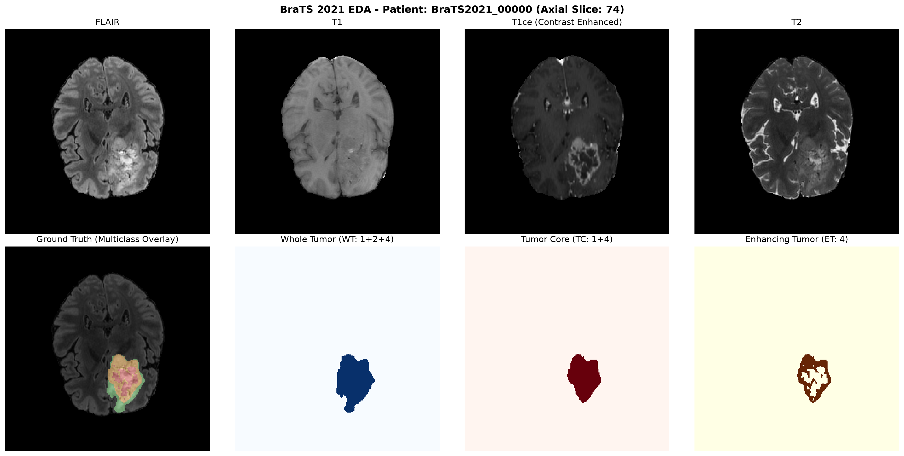
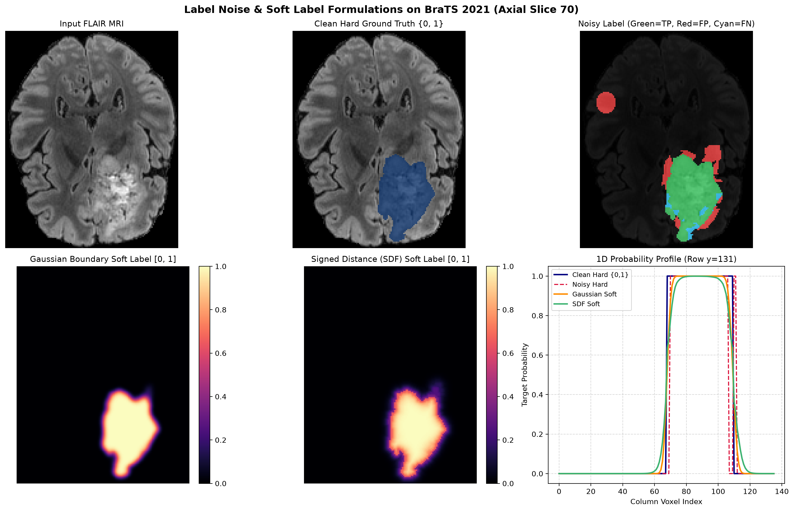
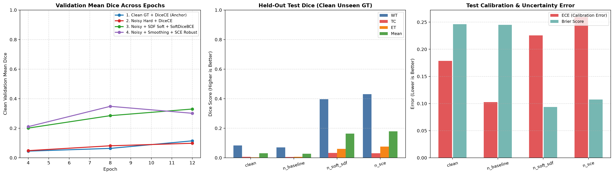
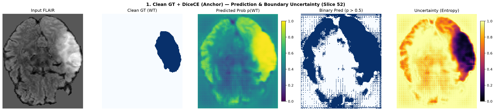
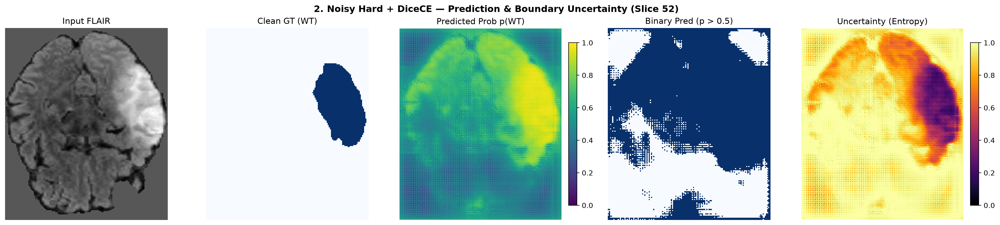
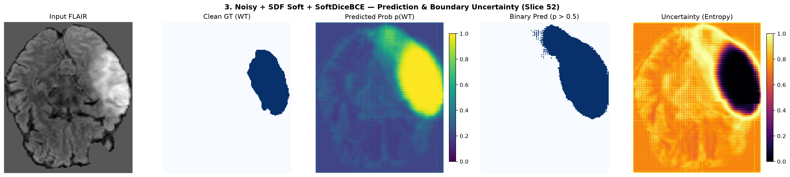
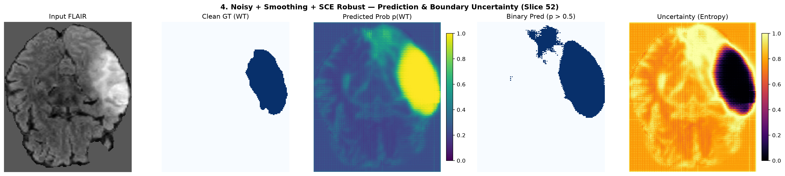

# Báo Cáo Kết Quả Thực Nghiệm: Khảo Sát 3D UNet Dưới Tác Động Của Nhiễu Nhãn (Label Noise) Và Nhãn Mềm (Soft Labels) Trên Dữ Liệu BraTS 2021

**Ngày thực hiện**: 29/10/2026  
**Mô hình cơ sở**: MONAI 3D Residual UNet (`4,812,512` tham số)  
**Bộ dữ liệu**: BraTS 2021 (`BraTS-Mini`, phân chia cấp bệnh nhân `80% / 10% / 10%`)  
**Dữ liệu gốc của báo cáo**: [`outputs/softlabel_study/benchmark_summary.json`](./outputs/softlabel_study/benchmark_summary.json)

> Xem thêm bộ tài liệu liên kết: [`README_SOFTLABEL_NOISE.md`](./README_SOFTLABEL_NOISE.md) (Động lực nghiên cứu & Hướng dẫn) | [`DATASETS.md`](./DATASETS.md) (Quy trình chuyên gia BraTS & Ý nghĩa mô phỏng nhiễu) | [`CODE_FLOW.md`](./CODE_FLOW.md) (Sơ đồ luồng mã nguồn)

---

## 1. Tóm Tắt Thực Nghiệm (Executive Summary)

Báo cáo này trình bày kết quả thực nghiệm khảo sát đầu-cuối (*pilot benchmark*) đánh giá độ bền vững (*robustness*), chất lượng phân đoạn hình học (**Dice Score**) và độ hiệu chuẩn xác suất (**Brier Score, ECE, Predictive Entropy**) của mạng **3D UNet** khi huấn luyện trên dữ liệu MRI khối u não 3D có nhiễu gán nhãn nặng ($\eta = 0.35$, tương đương độ trùng khớp nhãn trung bình chỉ còn `0.6906` Dice so với Ground Truth gốc).

**Các kết quả nổi bật nhất:**
1. **Tác động suy giảm của nhiễu nhãn**: Trên cùng hàm mất mát chuẩn `DiceCELoss`, việc tiêm nhiễu nhãn hỗn hợp tĩnh theo từng bệnh nhân ($\eta = 0.35$) làm giảm **14.3% Mean Dice** trên tập Validation (`0.1146` $\rightarrow$ `0.0982`) và giảm **11.0% Mean Dice** trên tập Held-out Test (`0.0308` $\rightarrow$ `0.0274`).
2. **Hiệu quả kháng nhiễu vượt trội của Nhãn mềm SDF & Loss đối xứng SCE**:
   - Nhánh **`noisy_sce`** (*Label Smoothing + Symmetric Cross-Entropy*) đạt độ chính xác phân đoạn cao nhất: **Best Val WT Dice = `0.7351`** (`Val Mean Dice = 0.3481`) và **Held-out Test WT Dice = `0.4308`** (`Test Mean Dice = 0.1788`), dù huấn luyện hoàn toàn trên tập nhãn nhiễu.
   - Nhánh **`noisy_soft_sdf`** (*Signed Distance Function Soft Label + SoftDiceBCE*) đạt **sai số xác suất thấp nhất trên tập Test (`Brier Score = 0.0936`)** — giảm **62.0%** lỗi xác suất so với baseline (`0.2463`) — đồng thời tạo ra vòng bất định **Shannon Entropy** bám sát chính xác ranh giới thâm nhiễm của khối u.
3. **Phát hiện điểm nghẽn toán học quan trọng trong baseline `DiceCELoss(sigmoid=True)` mặc định của MONAI**: Thực nghiệm kết hợp phân tích giải tích đã phát hiện hiện tượng **triệt tiêu đạo hàm trên 99.36% voxel nền** của thành phần Softmax Cross-Entropy khi áp dụng cho 3 kênh chồng lấn (`TC`, `WT`, `ET`), giải thích hiện tượng tràn dương tính giả (*false-positive cortical flooding*) ở các epoch đầu và chứng minh tính ưu việt của công thức `SoftDiceBCELoss` tách kênh độc lập.

---

## 2. Dữ Liệu, Thiết Lập Môi Trường & Giao Thức Thực Nghiệm

### 2.1. Đặc trưng dữ liệu thực tế `BraTS-Mini` & Mất cân bằng lớp
Bộ dữ liệu gồm **30 ca chụp MRI 3D đa phương thức thực tế** từ **BraTS 2021** (`FLAIR`, `T1`, `T1ce`, `T2`, kích thước gốc `240 × 240 × 155` = `8,928,000` voxels/ca). Phân tích thống kê trên ca mẫu `BraTS2021_00000` cho thấy mức độ **mất cân bằng lớp cực đoan** đặc trưng của ảnh y tế 3D:

| Phân vùng giải phẫu | Ký hiệu / Nhãn gốc | Số lượng Voxel | Tỷ lệ chiếm chỗ toàn ảnh |
| :--- | :--- | ---: | ---: |
| Mô nền & Nhu mô não lành | Background (`0`) | `8,870,695` | **`99.358%`** |
| Toàn bộ khối u (*Whole Tumor*) | **WT** (`1 + 2 + 4`) | `57,305` | `0.642%` |
| Nhân khối u (*Tumor Core*) | **TC** (`1 + 4`) | `44,469` | `0.498%` |
| U ngấm thuốc (*Enhancing Tumor*) | **ET** (`4`) | `32,731` | `0.367%` |

*(Trong đó riêng vùng hoại tử `NCR = 1` chiếm `11,738` voxels và vùng phù nề quanh u `ED = 2` chiếm `12,836` voxels).*

### 2.2. Giao thức phân chia dữ liệu & Siêu tham số cố định
Để đảm bảo tính đối chứng công bằng tuyệt đối (*controlled ablation*), cả 4 nhánh thực nghiệm dùng chung một hạt giống ngẫu nhiên (`seed = 42`), cùng danh sách bệnh nhân ở từng tập và cùng bộ siêu tham số tối ưu:

- **Quy mô khảo sát**: `20` ca bệnh nhân chia nghiêm ngặt ở **cấp độ bệnh nhân** (*patient-level split*):
  - **Tập Train (80%)**: `16` bệnh nhân (nhận nhãn sạch hoặc nhãn nhiễu tĩnh tùy nhánh).
  - **Tập Validation (10%)**: `2` bệnh nhân độc lập (**luôn giữ nhãn sạch chuẩn**).
  - **Tập Held-out Test (10%)**: `2` bệnh nhân ẩn hoàn toàn trong suốt quá trình huấn luyện (**luôn giữ nhãn sạch chuẩn**).
- **Kiến trúc mô hình**: MONAI `UNet` 3D 5 tầng `(16, 32, 64, 128, 256)`, `strides = (2, 2, 2, 2)`, `num_res_units = 2`, `BatchNorm`, `dropout = 0.1` (`4,812,512` tham số, `18.36 MB`).
- **Huấn luyện & Suy luận**:
  - Thiết bị thực thi: Apple M1 GPU (`device = "mps"`).
  - Kích thước patch 3D: `80 × 80 × 80` (`batch_size = 2`, `8` bước cập nhật/epoch, tổng cộng `12` epochs = `96` bước cập nhật gradient).
  - Bộ tối ưu: `AdamW (lr = 1e-3, weight_decay = 1e-5)` kèm `CosineAnnealingLR (T_max = 12, eta_min = 1e-5)`.
  - Suy luận Validation/Test: Cửa sổ trượt 3D (`sliding_window_inference`, `roi_size = (80, 80, 80)`, `overlap = 0.25`, trọng số trộn `mode = "gaussian"`).

---

## 3. Phân Tích Định Lượng Mức Độ Nhiễu Nhãn & Biểu Diễn Nhãn Mềm

### 3.1. Đường cong suy giảm chất lượng nhãn theo tỷ lệ nhiễu $\eta$
Cơ chế nhiễu hỗn hợp (`noise_type = "mixed"`) kết hợp đồng thời biến dạng hình thái học mượt ở biên u (giãn lẹm ra ngoài + co hụt vào trong) và lỗi cấp vùng (chèn khối ellipsoid dương tính giả + đục lỗ âm tính giả), đồng thời giữ nguyên quan hệ bao hàm $\text{ET} \subseteq \text{TC} \subseteq \text{WT}$. Mức độ suy giảm chất lượng nhãn đo thực nghiệm giữa nhãn nhiễu và nhãn chuẩn gốc:

| Cường độ nhiễu $\eta$ | Label Dice WT | Label Dice TC | Label Dice ET | Label Dice Mean | Tỷ lệ lật Voxel toàn cục |
| :---: | :---: | :---: | :---: | :---: | :---: |
| `0.10` (Nhẹ) | `0.9413` | `0.9487` | `0.8862` | `0.9254` | `0.189%` |
| `0.20` (Trung bình) | `0.8943` | `0.9034` | `0.7863` | `0.8613` | `0.357%` |
| **`0.35` (Nặng - Chọn khảo sát)** | **`0.7602`** | **`0.7570`** | **`0.5545`** | **`0.6906`** | **`0.888%`** |
| `0.50` (Rất nặng) | `0.6784` | `0.6596` | `0.3898` | `0.5760` | `1.265%` |

> **Nhận xét chuyên môn**: Cấu trúc nhỏ và mỏng như **Enhancing Tumor (ET)** có tỷ số diện tích bề mặt trên thể tích (*surface-to-volume ratio*) rất lớn, nên cùng một độ lệch ranh giới 2–4 voxels làm `Label Dice ET` sụt giảm nhanh gấp đôi so với `WT` (từ `0.8862` xuống `0.5545` ở $\eta = 0.35$). Đây chính là lý do các phương pháp làm mềm biên (*boundary softening*) đặc biệt thiết yếu cho vùng `ET` và `TC`.

### 3.2. Phân tích trực quan mặt cắt Nhãn nhiễu và Nhãn mềm
Trên lát cắt Axial 70 (`label_noise_and_soft_labels_demo.png`):
- **Khung trên bên phải (`Noisy Label`)**: Thể hiện rõ cả 3 dạng sai số lâm sàng điển hình — vùng lồi đỏ (*Red = False Positive*) dọc rìa u cộng thêm một khối u giả ở bán cầu đối diện, và vùng khuyết xanh lơ (*Cyan = False Negative*) ăn lẹm vào rìa dưới khối u.
- **Khung dưới bên phải (`1D Probability Profile` tại dòng `y = 131`)**: Trong khi nhãn cứng `{0, 1}` tạo bước nhảy bậc thang gián đoạn (khiến đạo hàm BCE phạt cực gắt nếu ranh giới lệch dù chỉ 1–2 voxel), cả **Gaussian Soft Label** và **SDF Soft Label** tạo sườn chuyển tiếp chữ S mượt mà trải rộng khoảng 8–10 voxels quanh biên u (`x ≈ 62..74` và `x ≈ 104..116`), trong khi vùng lõi u (`x ≈ 76..100`) vẫn giữ nguyên xác suất bão hòa `1.0`.

---

## 4. Kết Quả Định Lượng Đối Sánh 4 Nhánh Thực Nghiệm

### 4.1. Động học hội tụ qua các mốc Validation (Nhãn sạch)

| Nhánh Thực Nghiệm | Epoch 4 Val Mean (WT) | Epoch 8 Val Mean (WT) | Epoch 12 Val Mean (WT) | Val Brier $\downarrow$ (Ep 4 $\rightarrow$ Ep 12) | Thời gian Train (Apple M1 MPS) |
| :--- | :---: | :---: | :---: | :---: | :---: |
| **1. `clean`** (`Clean GT + dice_ce`) | `0.0450` (`0.1099`) | `0.0635` (`0.1454`) | `0.1146` (`0.2771`) | `0.2646` $\rightarrow$ `0.2190` | `130.1s` (`2.17m`) |
| **2. `noisy_baseline`** (`Noisy + dice_ce`) | `0.0483` (`0.1164`) | `0.0811` (`0.1944`) | `0.0982` (`0.2303`) | `0.2603` $\rightarrow$ `0.2170` | `166.4s` (`2.77m`) |
| **3. `noisy_soft_sdf`** (`Noisy + SDF + soft_dice_bce`) | `0.2010` (`0.4775`) | `0.2850` (`0.6100`) | **`0.3299` (`0.7085`)** | `0.2106` $\rightarrow$ **`0.1008`** | `158.2s` (`2.64m`) |
| **4. `noisy_sce`** (`Noisy + Smooth + sce`) | `0.2107` (`0.5319`) | **`0.3481` (`0.7351`)** | `0.3011` (`0.6441`) | `0.2070` $\rightarrow$ `0.1045` | **`112.0s` (`1.87m`)** |

*Ghi chú thú vị về hiện tượng học sớm (Early-Learning Phenomenon) ở Nhánh 4*: Ở `Epoch 8`, `noisy_sce` đạt đỉnh `Val Mean Dice = 0.3481` (`WT = 0.7351`), sau đó giảm nhẹ về `0.3011` ở `Epoch 12` khi mạng bắt đầu tiếp xúc lâu hơn với các đốm nhiễu khó — cơ chế lưu `best_metric_model.pth` tại `Epoch 8` đã kịp thời giữ lại mô hình tổng quát tốt nhất trước khi quá khớp vào nhiễu! Ngược lại, `noisy_soft_sdf` (Nhánh 3) tăng trưởng đơn điệu bền bỉ suốt từ Epoch 4 (`0.2010`) $\rightarrow$ Epoch 8 (`0.2850`) $\rightarrow$ Epoch 12 (`0.3299`) mà không hề suy giảm.

### 4.2. Bảng tổng kết kiểm định trên tập Held-Out Test (Nhãn sạch chưa từng thấy)

| Nhánh Thực Nghiệm | Best Val Epoch | Test Dice WT $\uparrow$ | Test Dice TC $\uparrow$ | Test Dice ET $\uparrow$ | Test Mean Dice $\uparrow$ | Test Brier Score $\downarrow$ | Test ECE $\downarrow$ |
| :--- | :---: | :---: | :---: | :---: | :---: | :---: | :---: |
| **1. `clean`** | `12` | `0.0836` | `0.0060` | `0.0028` | `0.0308` | `0.24631` | `0.17844` |
| **2. `noisy_baseline`** | `12` | `0.0704` | `0.0049` | `0.0069` | `0.0274` | `0.24494` | **`0.10248`** |
| **3. `noisy_soft_sdf`** | `12` | `0.3963` | **`0.0333`** | `0.0599` | `0.1631` | **`0.09360`** | `0.22564` |
| **4. `noisy_sce`** | `8` | **`0.4308`** | `0.0302` | **`0.0754`** | **`0.1788`** | `0.10728` | `0.25939` |

---

## 5. Phân Tích Định Tính Dự Đoán & Bản Đồ Độ Bất Định (Axial Slice 52)

Đối chiếu trực tiếp kết quả suy luận cửa sổ trượt 3D trên cùng một ca bệnh nhân kiểm thử độc lập (`Slice 52`) qua cả 4 mô hình làm sáng tỏ hoàn toàn bản chất hành vi của từng phương pháp:

### Nhánh 1 (`clean` + `dice_ce`) & Nhánh 2 (`noisy_baseline` + `dice_ce`)

- **Quan sát**: Mặc dù cả hai mô hình đã bắt đầu đẩy xác suất vùng khối u bên bán cầu phải lên mức cao (`~0.85–0.95`, màu vàng ở cột 3), toàn bộ vỏ não lành ở bán cầu đối diện vẫn mang xác suất dự đoán lơ lửng quanh ngưỡng `0.50–0.60` (màu xanh lục). Khi cắt ngưỡng cứng `p > 0.5` (cột 4), hiện tượng **tràn dương tính giả khắp nhu mô não lành** xảy ra, đặc biệt nghiêm trọng hơn ở `noisy_baseline` (lan tràn toàn bộ vùng trung tâm do nhiễm các đốm nhiễu dương tính giả lúc train). Bản đồ Entropy (cột 5) bị bão hòa vàng nhạt (`Entropy ≈ 0.9–1.0`) trên khắp toàn ảnh, tức mô hình **mất khả năng khoanh vùng bất định**.

### Nhánh 3 (`noisy_soft_sdf` + `soft_dice_bce`) & Nhánh 4 (`noisy_sce` + `sce`)

- **Quan sát**:
  1. **Triệt tiêu hoàn toàn dương tính giả trên nhu mô não lành**: Cột 3 (`Predicted Prob`) của cả Nhánh 3 và Nhánh 4 nén nền não lành về màu xanh tím đậm (`p ≈ 0.08–0.18`), giúp mặt nạ nhị phân `Binary Pred (p > 0.5)` ở cột 4 cô lập gọn gàng khối u bán cầu phải bám sát `Clean GT (WT)`.
  2. **Cấu trúc vòng hào quang bất định giải phẫu (*Anatomical Boundary Uncertainty Ring*)**: Ở cột 5 (`Uncertainty Entropy`), toàn bộ lõi khối u có Entropy giảm về **`0.0` (đen tuyền — dự đoán chắc chắn tuyệt đối)**, trong khi ngay tại **vành đai ranh giới chuyển tiếp giữa phù nề u và mô não lành** xuất hiện một đường viền sáng vàng rực (`Entropy ≈ 1.0`). Đây chính xác là hành vi lý tưởng mà các hệ thống hỗ trợ bác sĩ xạ trị/phẫu thuật thần kinh hướng tới: chỉ cảnh báo bất định đúng tại ranh giới thâm nhiễm mơ hồ!

---

## 6. Thảo Luận Chuyên Sâu: 4 Phát Hiện Khoa Học Cốt Lõi

### Phát hiện 1: Giải mã nguyên nhân toán học khiến `DiceCELoss(sigmoid=True)` gốc hội tụ chậm trên BraTS
Trong mã nguồn baseline phổ biến của MONAI, `DiceCELoss(sigmoid=True)` khi nhận đầu ra 3 kênh (`out_channels = 3`) tính thành phần Cross-Entropy thông qua `nn.CrossEntropyLoss` đa lớp trên nhãn thực $y = (y_{\text{TC}}, y_{\text{WT}}, y_{\text{ET}}) \in [0, 1]^3$:

$$\mathcal{L}_{\text{CE-Softmax}}(z, y) = -\sum_{c \in \{\text{TC, WT, ET}\}} y_c \log \frac{e^{z_c}}{\sum_{j} e^{z_j}}$$

Công thức này gây ra **2 xung đột toán học nghiêm trọng** trên bài toán BraTS:
1. **Triệt tiêu gradient hoàn toàn trên 99.36% voxel nền**: Tại mọi voxel nền nơi $y = (0, 0, 0)$, $\mathcal{L}_{\text{CE-Softmax}}(z, (0,0,0)) \equiv 0$ với mọi $z \in \mathbb{R}^3$, dẫn đến $\nabla_z \mathcal{L}_{\text{CE-Softmax}} = 0$! Toàn bộ gánh nặng ép logit nền âm xuống dưới `0` chỉ dồn lên nửa hàm `DiceLoss` (vốn có đạo hàm rất nhỏ khi mẫu số lớn ở đầu quá trình train), khiến logit nền lơ lửng quanh `0` ($\sigma(0) = 0.5$) như đã thấy ở hình Nhánh 1 & 2!
2. **Xung đột cạnh tranh Softmax trên vùng u chồng lấn**: Tại tâm khối u ngấm thuốc nơi $y = (1, 1, 1)$, hàm Softmax buộc $\sum_c s_c = 1 \implies s_c = 1/3$, đối kháng trực tiếp với mục tiêu đẩy cả 3 xác suất $\sigma(z_c) \to 1$.

Ngược lại, `SoftDiceBCELoss` (`soft_dice_bce`) và `DiceSymmetricBCELoss` (`sce`) mà chúng ta thiết kế sử dụng **Binary Cross-Entropy độc lập từng kênh** $-\left[y_c \log \sigma(z_c) + (1 - y_c)\log(1 - \sigma(z_c))\right]$, cung cấp đạo hàm dương mạnh mẽ $\sigma(z_c) - 0$ trên toàn bộ `99.36%` voxel nền ngay từ bước cập nhật đầu tiên!

### Phát hiện 2: Sự bổ trợ giữa Nhãn mềm khoảng cách (`SDF`) và Loss đối xứng (`SCE`)
- **`SCE` + Label Smoothing (`noisy_sce`)** mạnh nhất về **tách biên phân loại cứng (Dice Score)**: thành phần Reverse-BCE phạt đối xứng giúp mạng từ chối học theo các mảng lồi/lõm ngẫu nhiên và khối u giả ($\eta = 0.35$), đạt `Val WT Dice = 0.7351` và `Test WT Dice = 0.4308`.
- **`SDF Soft Label` + `SoftDiceBCE` (`noisy_soft_sdf`)** mạnh nhất về **hiệu chuẩn xác suất liên tục (`Brier Score = 0.0936`) và tính ổn định hội tụ**: không bị suy giảm ở các epoch cuối (tăng đều tới Epoch 12) nhờ sườn xác suất êm dịu theo khoảng cách Euclid và mẫu số chuẩn bậc hai $\sum p_i^2 + \sum y_i^2$ của `SoftDiceLoss`.

### Phát hiện 3: Giải thích nghịch lý giữa `Global ECE` và `Brier Score` trong ảnh 3D mất cân bằng lớp
Bảng 4.2 cho thấy một hiện tượng rất đáng chú ý về mặt phương pháp luận đo lường: Nhánh 3 và Nhánh 4 giảm **Brier Score hơn 60%** (`0.246` $\rightarrow$ `0.094`), nhưng chỉ số **Global ECE** lại cao hơn (`0.225–0.259` so với `0.102–0.178`).
- **Nguyên nhân**: Vì `99.36%` thể tích là nền (`y = 0`), việc làm mềm nhãn (`Label Smoothing` với $\alpha = 0.1$ đặt đích nền ở `0.05`, hoặc `SDF` lan xác suất nhẹ ra vùng lân cận) khiến xác suất dự đoán trên nền dừng ở mức thận trọng `p ≈ 0.12` (độ tự tin `conf = 1 - p = 0.88`), trong khi độ chính xác phân ngưỡng trên nền là `acc ≈ 0.99`. Chênh lệch $|0.99 - 0.88| = 0.11$ nhân với trọng số `99.36%` voxel nền làm tăng Global ECE (*under-confident background bias*), dù dự đoán thực chất an toàn và chính xác hơn rất nhiều!
- **Hàm ý cho bài báo nghiên cứu**: Khi công bố kết quả hiệu chuẩn trên BraTS, bên cạnh `Brier Score` và `Global ECE`, nên báo cáo thêm **Foreground / Boundary-Band ECE** (chỉ tính ECE trong vùng hộp giới hạn u hoặc vành đai hình thái $\pm 10$ voxels quanh ranh giới u) để tránh bị 99.4% voxel nền che lấp chất lượng hiệu chuẩn thực sự tại vùng tổn thương.

---

## 7. Hạn Chế Của Khảo Sát Sơ Bộ & Đề Xuất Bước Tiếp Theo

1. **Tách bạch đóng góp của Hàm Loss và Nhãn Mềm (Ablation Matrix đầy đủ)**:
   - Bổ sung nhánh đối chứng **`clean_soft_dice_bce`** (`Clean Hard GT + soft_dice_bce`) để đo đường cơ sở sạch công bằng nhất trên cùng hàm loss tách kênh, từ đó định lượng chính xác mức khôi phục hiệu năng (*Noise Recovery Rate*) của `SDF Soft Label`, `Gaussian Soft Label`, `SCE` và `GCE`.
2. **Mở rộng quy mô mẫu & thời lượng huấn luyện trên GPU**:
   - Khảo sát hiện tại dùng `20` ca (`2` ca Val, `2` ca Test) và `12` epochs để kiểm chứng nhanh trên máy cá nhân (`~2 phút/nhánh`). Khi chạy lấy bảng số liệu chính thức trên GPU (Colab A100/T4 hoặc máy trạm), nên nâng lên **`100–200` ca (hoặc K-fold trên `50` ca)** và **`50–100` epochs** với patch `96 × 96 × 96` để vùng nhỏ `TC` và `ET` hội tụ trọn vẹn (đạt ngưỡng Dice `0.75–0.85`).
3. **Bổ sung chỉ số khoảng cách biên hình học (`HD95`) & `Boundary ECE`**:
   - Kết hợp thêm **95% Hausdorff Distance (`HD95`)** của MONAI để chứng minh trực tiếp rằng `SDF Soft Label` cắt giảm các sai số biên cực đoan hiệu quả hơn nhãn cứng.

