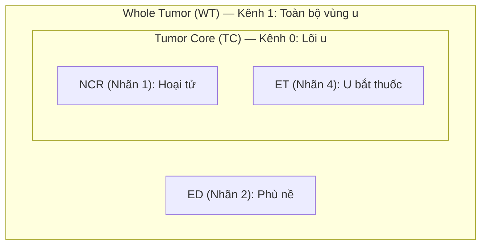

# Cẩm Nang Đặc Tả & Cơ Chế Đo Lường Các Metrics Đánh Giá BraTS 2021
**Tiêu chuẩn**: RSNA-ASNR-MICCAI Brain Tumor Segmentation (BraTS) 2021 Challenge  
**Phạm vi áp dụng**: Đánh giá định lượng trên toàn bộ thể tích 3D (Full 3D Patient Volume)

---

## 1. Cấu Trúc Vùng Tổn Thương Phân Cấp (Hierarchical Sub-Regions)

Trong cuộc thi BraTS 2021, nhãn gán vi thể của chuyên gia X-quang thần kinh bao gồm 4 giá trị số học nguyên bản trên ảnh MRI:
- `Nhãn 0`: Vùng mô não lành hoặc nền đen (Background)
- `Nhãn 1`: Vùng hoại tử không bắt thuốc (Necrotic Tumor Core - NCR)
- `Nhãn 2`: Vùng phù nề quanh u (Peritumoral Edematous Tissue - ED)
- `Nhãn 4`: Vùng u hoạt tính bắt thuốc tương phản từ Gd (GD-enhancing Tumor - ET)
*(Lưu ý: Nhãn 3 không được sử dụng trong BraTS từ năm 2017 đến nay)*

Để phục vụ chẩn đoán lâm sàng và lập kế hoạch xạ trị/phẫu thuật, ban tổ chức BraTS không đánh giá riêng rẽ từng nhãn 1, 2, 4 mà kết hợp thành **3 cấu trúc u lồng nhau (Hierarchical Overlapping Sub-Regions)**:

### Định nghĩa toán học của 3 kênh đầu ra:
1. **Tumor Core (TC — Lõi u — Kênh 0)**:
   $$\text{TC} = \text{NCR} \cup \text{ET} \quad (\text{Nhãn } 1 \cup 4)$$
   *Ý nghĩa lâm sàng*: Đại diện cho phần mô khối u đặc cần được phẫu thuật cắt bỏ hoặc chiếu xạ liều cao.
2. **Whole Tumor (WT — Toàn bộ u — Kênh 1)**:
   $$\text{WT} = \text{NCR} \cup \text{ED} \cup \text{ET} \quad (\text{Nhãn } 1 \cup 2 \cup 4)$$
   *Ý nghĩa lâm sàng*: Đại diện cho toàn bộ vùng mô não bị tổn thương xâm lấn, bao gồm cả vùng phù nề phản ứng.
3. **Enhancing Tumor (ET — U bắt thuốc — Kênh 2)**:
   $$\text{ET} = \text{ET} \quad (\text{Nhãn } 4)$$
   *Ý nghĩa lâm sàng*: Vùng tế bào u ác tính đang tăng sinh mạch mạnh, phá vỡ hàng rào máu não (Blood-Brain Barrier).

> [!IMPORTANT]
> **Tại sao sử dụng Multi-label Sigmoid độc lập thay vì Softmax đa lớp?**
> Vì 3 cấu trúc trên có sự giao thoa lồng ghép ($\text{ET} \subset \text{TC} \subset \text{WT}$), một voxel thuộc ET cũng đồng thời thuộc TC và WT. Việc sử dụng Softmax chuẩn hóa xác suất $\sum p_c = 1$ sẽ tạo ra sự cạnh tranh phi lý giữa các lớp lồng nhau. Do đó, hệ thống sử dụng **3 hàm Sigmoid độc lập**:
> $$p_c = \sigma(z_c) = \frac{1}{1 + e^{-z_c}}, \quad c \in \{\text{TC}, \text{WT}, \text{ET}\}$$
> và nhị phân hóa độc lập với ngưỡng quyết định $p_c > 0.5$.

---

## 2. Định Nghĩa & Công Thức Toán Học Của Từng Metric

Gọi $P_c \in \{0, 1\}^{H \times W \times D}$ là mặt nạ nhị phân dự đoán của kênh $c$, và $G_c \in \{0, 1\}^{H \times W \times D}$ là mặt nạ Ground Truth tương ứng của bệnh nhân.

### 2.1. Volumetric Dice Similarity Coefficient (DSC) — Đo lường độ trùng lặp thể tích
Dice Coefficient là chỉ số đánh giá độ tương đồng diện tích/thể tích cốt lõi trong phân đoạn ảnh y tế:
$$DSC(P, G) = \frac{2 \cdot |P \cap G|}{|P| + |G|} = \frac{2 \sum_{i} P_i G_i}{\sum_{i} P_i + \sum_{i} G_i}$$
- **Phạm vi**: $[0.0, 1.0]$. Giá trị càng cao càng tốt ($1.0$ thể hiện sự trùng khớp tuyệt đối).
- **Tính chất**: Phạt nặng cả lỗi dương tính giả (False Positives - dự đoán thừa) lẫn âm tính giả (False Negatives - bỏ sót).

### 2.2. 95% Hausdorff Distance ($HD_{95}$ tính bằng mm) — Đo lường độ sai lệch đường biên
Trong phẫu thuật thần kinh, việc đường biên u lệch vài milimet ra ngoài có thể cắt phạm vào mô não lành quan trọng (vùng ngôn ngữ, vận động). $HD_{95}$ đo khoảng cách hình học lớn nhất giữa bề mặt dự đoán $\partial P$ và bề mặt thực tế $\partial G$.

Gọi $d(x, Y) = \min_{y \in Y} \|x - y\|_2$ là khoảng cách Euclid ngắn nhất từ điểm $x$ tới tập hợp điểm $Y$. Khoảng cách Hausdorff có hướng phân vị thứ 95 là:
$$h_{95}(X, Y) = \text{percentile}_{95} \left( \{ d(x, Y) \mid x \in X \} \right)$$
Khoảng cách Hausdorff 95% đối xứng hai chiều là:
$$HD_{95}(P, G) = \max \left( h_{95}(\partial P, \partial G), \, h_{95}(\partial G, \partial P) \right) \times \text{spacing}$$
- **Đơn vị**: Milimet (mm), sử dụng voxel spacing thực tế $[1.0, 1.0, 1.0]\text{ mm}$.
- **Phạm vi**: $[0.0, +\infty)$. Giá trị càng nhỏ càng tốt ($0.0\text{ mm}$ là hoàn hảo).
- **Tại sao lấy phân vị 95% thay vì cực đại 100%?**
  Khoảng cách Hausdorff cực đại cực kỳ nhạy cảm với 1 vài voxel nhiễu lẻ tẻ ngoài biên (outlier noise). Phân vị 95% loại bỏ 5% điểm biên ngoại lai cực đoan nhất, tạo ra thước đo bền vững và phản ánh chân thực hình dạng giải phẫu của khối u.
- **Phương pháp tính toán**: Sử dụng phép biến đổi khoảng cách Euclid 3D (3D Euclidean Distance Transform - EDT) thông qua `scipy.ndimage.distance_transform_edt` với thời gian thực thi siêu tốc (~0.03s mỗi ca).

### 2.3. Intersection over Union (IoU / Jaccard Index)
$$IoU(P, G) = \frac{|P \cap G|}{|P \cup G|} = \frac{|P \cap G|}{|P| + |G| - |P \cap G|}$$
- **Mối quan hệ chặt chẽ với Dice**:
  $$IoU = \frac{DSC}{2 - DSC}, \quad DSC = \frac{2 \cdot IoU}{1 + IoU}$$
- IoU luôn có giá trị $\le DSC$ và phạt các lỗi không trùng khớp nghiêm khắc hơn Dice.

### 2.4. Sensitivity (Recall / True Positive Rate) — Tránh bỏ sót khối u
$$\text{Sensitivity}(P, G) = \frac{|P \cap G|}{|G|} = \frac{TP}{TP + FN}$$
- Đo lường tỷ lệ phần trăm thể tích u thực tế được mô hình phát hiện thành công.
- Rất quan trọng trong xạ trị ung thư: bỏ sót thể tích u ($FN$) dẫn đến nguy cơ tái phát bệnh.

### 2.5. Precision (Positive Predictive Value / PPV) — Độ tin cậy dự đoán
$$\text{Precision}(P, G) = \frac{|P \cap G|}{|P|} = \frac{TP}{TP + FP}$$
- Đo lường mức độ tin cậy của vùng được mô hình gán nhãn u.
- Rất quan trọng trong bảo tồn chức năng thần kinh: dự đoán thừa ($FP$) dẫn đến việc cắt bỏ nhầm mô não lành.

---

## 3. Quy Ước Xử Lý Các Ca Biên Vùng Rỗng (Empty-Mask Edge Cases)

Một thách thức lớn trong dữ liệu thực tế BraTS là **một số bệnh nhân hoàn toàn không có vùng u bắt thuốc (Enhancing Tumor - ET)**, đặc biệt là nhóm u thần kinh đệm bậc thấp (Low-Grade Glioma - LGG). Khi đó Ground Truth rỗng: $|G_c| = 0$.

Quy ước chuẩn của cuộc thi RSNA-ASNR-MICCAI BraTS được cài đặt tường minh như sau:

| Trường hợp | Điều kiện toán học | Trạng thái | Dice | IoU | Sensitivity | Precision | $HD_{95}$ |
|---|---|---|:---:|:---:|:---:|:---:|:---:|
| **Ca 1: Cả hai cùng rỗng** | $|P| = 0$ và $|G| = 0$ | Khối u không tồn tại và mô hình dự đoán chính xác là rỗng | **1.0** | **1.0** | **1.0** | **1.0** | **0.0 mm** |
| **Ca 2: Ảo giác dương tính giả** | $|P| > 0$ và $|G| = 0$ | Thực tế không có u nhưng mô hình vẽ nhầm | **0.0** | **0.0** | **1.0** | **0.0** | **373.13 mm** |
| **Ca 3: Bỏ sót âm tính giả** | $|P| = 0$ và $|G| > 0$ | Bệnh nhân có u nhưng mô hình bỏ qua | **0.0** | **0.0** | **0.0** | **0.0** | **373.13 mm** |

### Cơ sở khoa học của giá trị phạt $373.13\text{ mm}$:
Khi một trong hai mặt nạ rỗng, khoảng cách hình học giữa hai bề mặt không xác định. Cuộc thi BraTS quy định mức phạt tối đa bằng đúng **độ dài đường chéo không gian lớn nhất của khối thể tích chuẩn hóa SRI24** ($240 \times 240 \times 155\text{ mm}^3$ tại voxel spacing $1 \times 1 \times 1\text{ mm}$):
$$D_{\max} = \sqrt{240^2 + 240^2 + 155^2} = \sqrt{57600 + 57600 + 24025} = \sqrt{139225} \approx 373.1287\text{ mm}$$

> [!WARNING]
> **Lỗi tiềm ẩn nghiêm trọng của MONAI `DiceMetric` mặc định**:
> Lớp `monai.metrics.DiceMetric` mặc định thiết lập tham số `ignore_empty=True`. Khi đó, bất cứ khi nào Ground Truth $|G| = 0$, MONAI sẽ âm thầm trả về `NaN` và loại bỏ mẫu đó khỏi quá trình tính trung bình!
> **Hậu quả**: Nếu mô hình bị ảo giác dự đoán ra một khối u giả trên bệnh nhân LGG (Ca 2), lỗi nghiêm trọng này sẽ **bị bỏ qua hoàn toàn và không bị phạt**!
> Codebase của chúng tôi đã khắc phục bằng cách thiết lập `ignore_empty=False` kết hợp với hàm chuyên dụng [`compute_binary_volume_metrics`](file:///Users/truongledanchi/.gemini/antigravity/scratch/test/src/loss_metric.py#L310-L370) để tuân thủ 100% chuẩn BraTS Challenge.

---

## 4. Cơ Chế Gom Cụm Điểm Số (Aggregation Protocol)

Hệ thống tuân thủ nguyên tắc gom cụm **Macro-average 2 cấp độ**:

1. **Cấp độ 1 — Gom cụm theo từng bệnh nhân (Patient-Level)**:
   Mọi chỉ số đều được tính trên thể tích 3D nguyên vẹn của từng bệnh nhân sau khi tái lập hoàn chỉnh từ `sliding_window_inference` (tuyệt đối không bao giờ tính trung bình trên các lát cắt 2D hay các patch nhỏ rời rạc).
2. **Cấp độ 2 — Gom cụm theo từng vùng (Region-Macro Average)**:
   Điểm số trung bình toàn tập kiểm thử được tính trung bình cộng không trọng số qua tất cả các bệnh nhân:
   $$\overline{DSC}_c = \frac{1}{N} \sum_{i=1}^N DSC(P_{i, c}, G_{i, c})$$
   $$\overline{HD95}_c = \frac{1}{N} \sum_{i=1}^N HD_{95}(P_{i, c}, G_{i, c})$$
3. **Cấp độ 3 — Chỉ số tổng kết toàn diện (Final Macro Mean)**:
   $$\text{Macro Mean Dice} = \frac{\overline{DSC}_{\text{WT}} + \overline{DSC}_{\text{TC}} + \overline{DSC}_{\text{ET}}}{3}$$
   $$\text{Macro Mean } HD_{95} = \frac{\overline{HD95}_{\text{WT}} + \overline{HD95}_{\text{TC}} + \overline{HD95}_{\text{ET}}}{3}$$
   Đây chính là giá trị chuẩn mực được dùng để xếp hạng và so sánh giữa các mô hình trong toàn bộ nghiên cứu.
